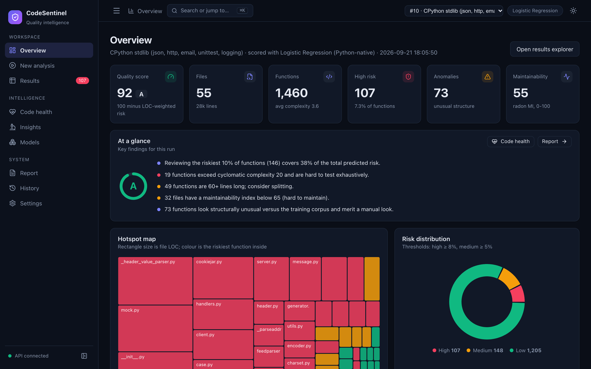
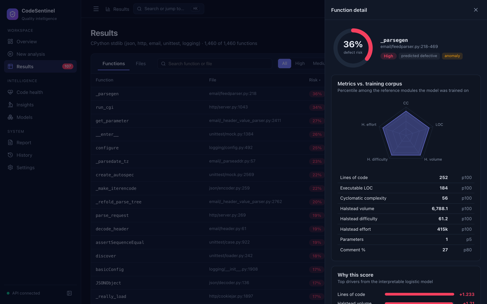
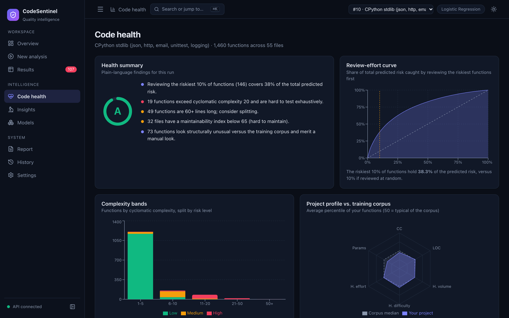
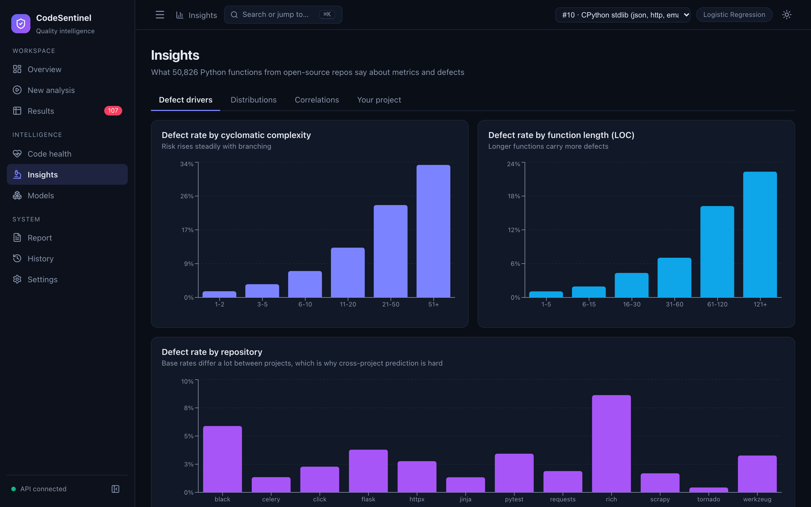
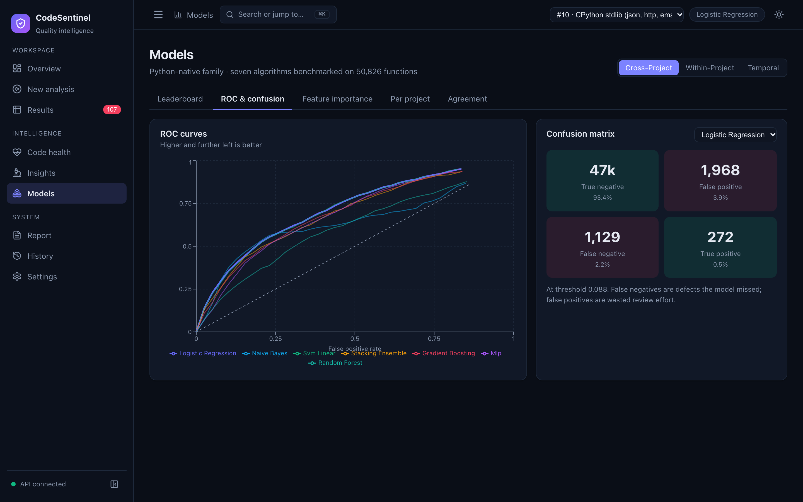

# CodeSentinel


**Software metrics and multi-model defect prediction.** Upload a project, measure every function, score its defect risk with seven ML models, and explore the result in a dashboard.

[Application walkthrough](docs/WALKTHROUGH.md) ·
[Sample projects](samples/README.md)



## What it does

| Step | What happens |
|---|---|
| **Ingest** | Upload a zip, paste code, or run the built-in demo (a slice of the CPython standard library). |
| **Measure** | [radon](https://radon.readthedocs.io) and [lizard](https://github.com/terryyin/lizard) compute LOC, cyclomatic complexity, Halstead volume/difficulty/effort, comment % and parameter count for every function. Python, Java, C/C++, JS/TS, Go and C# are parsed. |
| **Predict** | Seven models (logistic regression, naive Bayes, SVM, random forest, gradient boosting, MLP, stacking ensemble) score each function's defect probability. An Isolation Forest flags structurally unusual functions. |
| **Explain** | Per-function drivers, percentile vs. the training corpus, refactoring hints, a quality grade and an exportable report. |

## Pages

| Page | Purpose |
|---|---|
| **Overview** | Quality score and grade, findings, hotspot map, risk distribution, riskiest functions |
| **New analysis** | Upload a zip, paste a file or run the demo; choose model family and algorithm |
| **Results** | Search, filter, sort and export every function; detail drawer with drivers and hints |
| **Code health** | Review-effort curve, complexity bands, maintainability, hotspot matrix |
| **Insights** | What the training data says about metrics and defects, plus your project's profile |
| **Models** | Leaderboard, ROC, confusion matrix, feature importance, per-repository AUC, agreement |
| **Report** | Shareable summary; export as Markdown, JSON, CSV or PDF |
| **History** | Saved runs, trends and side-by-side comparison |
| **Settings** | Risk thresholds, default model and family, theme |

A command palette (<kbd>⌘</kbd>/<kbd>Ctrl</kbd>+<kbd>K</kbd>) jumps between pages. Every page is shown with annotated screenshots in the [walkthrough](docs/WALKTHROUGH.md).

## Screenshots

| | |
|---|---|
|  **Results.** Sortable, filterable functions with a detail drawer explaining each score. |  **Code health.** Review-effort curve, complexity bands and project profile. |
|  **Insights.** What the training data says about metrics and defects. |  **Models.** Leaderboard, ROC curves and confusion matrices. |

More: [new analysis](docs/screenshots/02-new-analysis.png) · [report](docs/screenshots/08-report.png) · [history](docs/screenshots/09-history.png) · [settings](docs/screenshots/10-settings.png) · [light theme](docs/screenshots/11-overview-light.png)

## Quick start

Requires Python 3.9+ and Node 18+.

```bash
make setup      # venv, backend and frontend dependencies
make train      # trains both model families (~7 min); models are not committed
make api        # API on http://localhost:8000  (docs at /docs)
make ui         # dashboard on http://localhost:5173  (separate terminal)
make test
```

Open http://localhost:5173, go to **New analysis**, and either run the demo or upload one of the sample zips below.

### Run without retraining

The dashboard needs trained model artifacts before it can score code. `make train` creates them locally from the committed datasets; the artifacts are deliberately excluded from version control because they are generated outputs. Once training completes, start the API and UI in separate terminals:

```bash
make api
make ui
```

To check the backend and metric extractor, run:

```bash
make test
```

## Try it with the sample projects

[`samples/`](samples/README.md) holds twelve small projects in the supported languages (clean, legacy and a before/after refactoring pair). Results with the default model:

| Sample | Language | Functions | Score | High | Medium | Riskiest function |
|---|---|---|---|---|---|---|
| [`01_python_clean_toolkit.zip`](samples/zips/01_python_clean_toolkit.zip) | Python | 7 | 99 (A) | 0 | 0 | `chunk` 2% |
| [`02_python_legacy_billing.zip`](samples/zips/02_python_legacy_billing.zip) | Python | 11 | 71 (C) | 1 | 1 | `calculate_invoice` 39% |
| [`03_java_shop.zip`](samples/zips/03_java_shop.zip) | Java | 25 | 73 (C) | 2 | 0 | `OrderProcessor::priceOrder` 40% |
| [`04_c_expression_parser.zip`](samples/zips/04_c_expression_parser.zip) | C | 8 | 80 (B) | 1 | 1 | `next_token` 27% |
| [`05_cpp_batch_scheduler.zip`](samples/zips/05_cpp_batch_scheduler.zip) | C++ | 10 | 77 (C) | 2 | 0 | `plan_batch` 32% |
| [`06_javascript_cart.zip`](samples/zips/06_javascript_cart.zip) | JavaScript | 12 | 71 (C) | 2 | 0 | `priceCart` 39% |
| [`07_typescript_pricing.zip`](samples/zips/07_typescript_pricing.zip) | TypeScript | 6 | 77 (C) | 2 | 0 | `priceItems` 31% |
| [`08_go_router.zip`](samples/zips/08_go_router.zip) | Go | 6 | 75 (C) | 2 | 0 | `PriceShipment` 34% |
| [`09_csharp_invoicing.zip`](samples/zips/09_csharp_invoicing.zip) | C# | 7 | 68 (D) | 2 | 0 | `InvoiceService::Calculate` 39% |
| [`10_polyglot_demo.zip`](samples/zips/10_polyglot_demo.zip) | All eight | 85 | 81 (B) | 14 | 2 | `OrderProcessor::priceOrder` 32% |
| [`11_refactor_before.zip`](samples/zips/11_refactor_before.zip) | Python | 3 | 65 (D) | 1 | 0 | `calculate_invoice` 39% |
| [`12_refactor_after.zip`](samples/zips/12_refactor_after.zip) | Python | 6 | 95 (A) | 0 | 2 | `calculate_invoice` 6% |
| Built-in demo (CPython stdlib) | Python | 1,460 | 92 (A) | 107 | 147 | `_parsegen` 36% |

The refactoring pair is the quickest demonstration: upload `11_refactor_before` and `12_refactor_after`, then tick both in **History** to see the score move from D to A. Regenerate the samples with `make samples`.

## Results

Default family: **Python-native**, trained on 50,826 function snapshots mined from 12 open-source repos (2.8% defective). A function is *defective* if a bug-fix commit modified it within 12 months of the snapshot. Full method in [docs/DATASET.md](docs/DATASET.md).

| Model | Cross-repo AUC | Temporal AUC | Recall @ top 10% |
|---|---|---|---|
| **Logistic regression** (default) | 0.735 | 0.739 | 34% |
| Naive Bayes | 0.735 | 0.738 | 36% |
| Linear SVM | 0.734 | 0.740 | 34% |
| Stacking ensemble | 0.719 | 0.745 | 30% |
| Gradient boosting | 0.718 | 0.741 | 30% |
| MLP | 0.718 | 0.708 | 26% |
| Random forest | 0.670 | 0.714 | 22% |

*Cross-repo*: train on 11 repos, test on the held-out one (mean AUC). *Temporal*: train on early snapshots, test on later ones. *Recall @ top 10%*: share of later bug-fixed functions found by reviewing only the riskiest 10%, about 3.4x better than random.

Simple models match or beat the ensembles at a 2.8% base rate, and probabilities are calibrated so a displayed 12% means roughly 12%. A second family trained on the NASA MDP C/C++ benchmark (12,211 modules) is included for comparison; it is out of domain for Python.

## Repository layout

```
backend/app/
  main.py          FastAPI routes
  metrics/         per-function metric extraction (radon + lizard)
  ml/              mining, training, inference, dataset analysis
  store.py         SQLite run history
backend/tests/     API, extractor and mining tests
frontend/src/      React + Vite dashboard (pages/, components/)
data/python/       mined dataset (dataset.csv) and its manifest
data/nasa/         NASA MDP cleaned ARFF files
ml/artifacts/      trained models (gitignored) and leaderboard.json per family
samples/           demo projects, zips and their generator
docs/              architecture, dataset method, API, walkthrough
  screenshots/     page screenshots and the annotated walkthrough set
```

## Documentation

- [Application walkthrough](docs/WALKTHROUGH.md): all pages with numbered legends
- [Architecture](docs/ARCHITECTURE.md): components, data flow, design decisions
- [Dataset and evaluation](docs/DATASET.md): how the labels are built and how models are compared
- [API reference](docs/API.md)
- [Sample projects](samples/README.md)

## Technology

- **Frontend:** React, Vite and Recharts
- **API:** FastAPI and Pydantic
- **Metrics:** Radon and Lizard
- **Machine learning:** scikit-learn
- **Storage:** SQLite for local analysis history

## Limitations

- Labels come from commit-message heuristics, which are noisy: silent fixes are missed and some non-bug "fix" commits are counted.
- Renamed or moved functions are treated as new functions.
- The 12 source repos are mostly libraries by experienced maintainers; scores may transfer less well to other kinds of code.
- Metrics alone plateau near 0.73 AUC. Use scores to prioritise review, not to gate releases.
- Comment percentage is measured for Python only; other languages report 0%, and the models were trained on Python, so scores for other languages are a relative ranking.
- The NASA family is trained on C/C++ and ranks Python functions less sensibly.

## License

[MIT](LICENSE)
