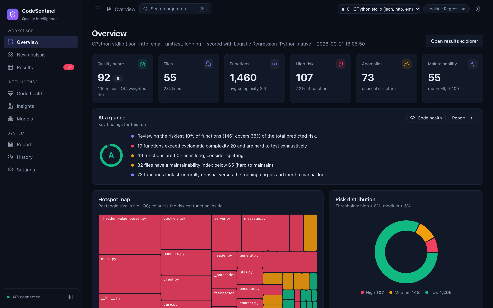
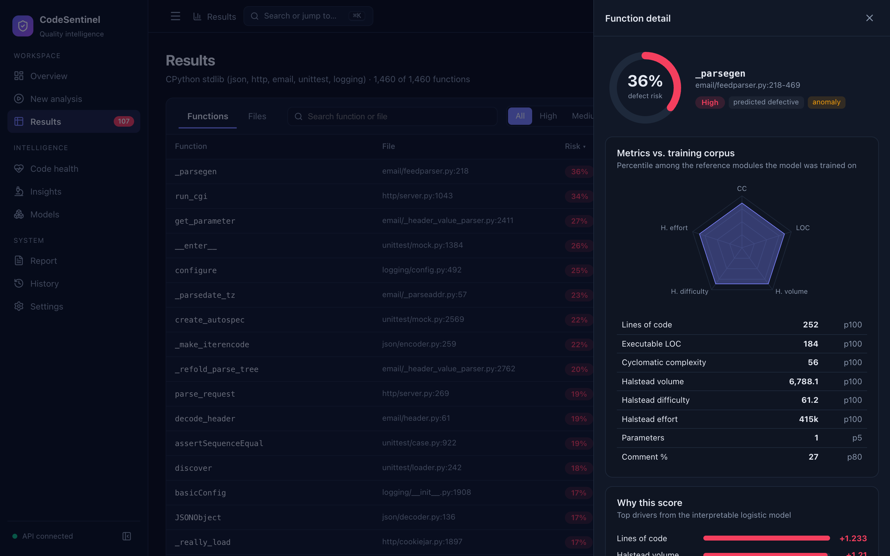
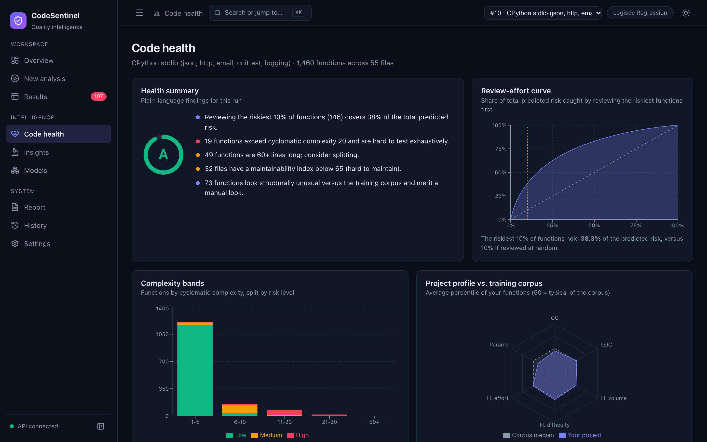
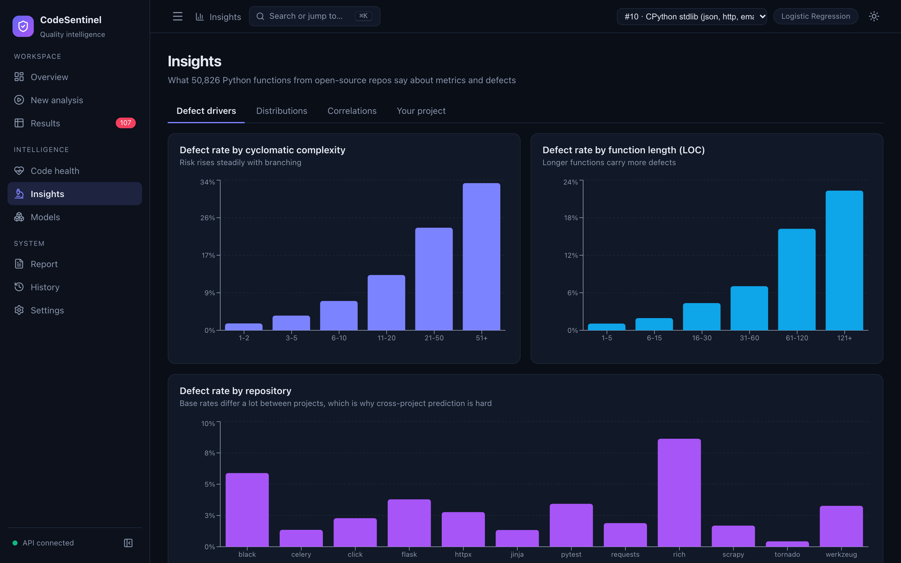
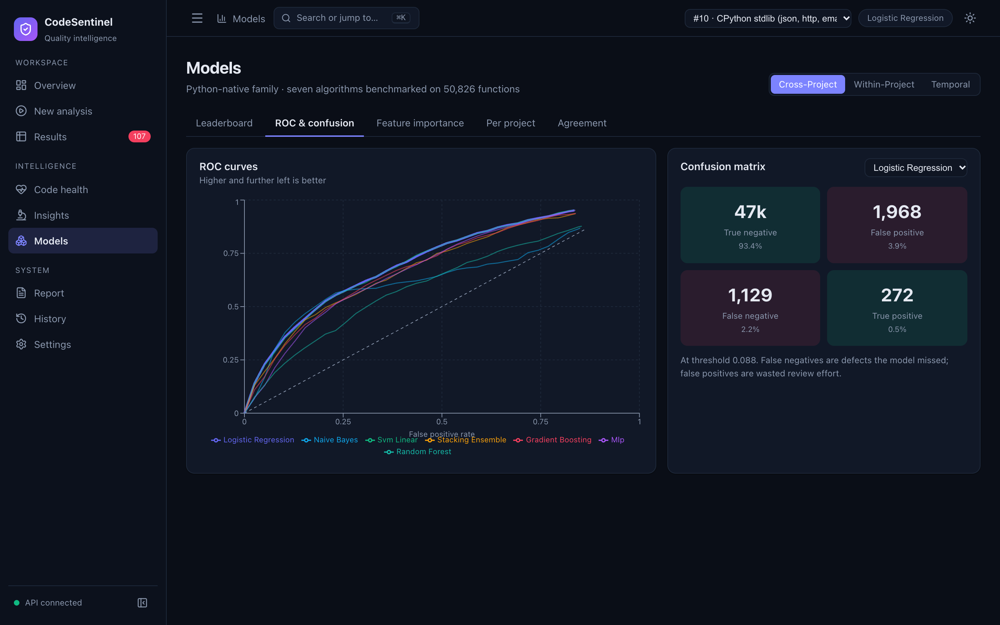

# CodeSentinel

[](https://github.com/anshultripathi-dev/codesentinel/actions/workflows/ci.yml)


**Software metrics and multi-model defect prediction.** Upload a project, measure every function, score its defect risk with seven ML models, and explore the result in a dashboard.

Built for the *Software Metrics* course (ISWE402L). Slides: [docs/CodeSentinel-Presentation.pdf](docs/CodeSentinel-Presentation.pdf).



## What it does

| Step | What happens |
|---|---|
| **Ingest** | Upload a zip, paste code, or run the built-in demo (a slice of the CPython standard library). |
| **Measure** | [radon](https://radon.readthedocs.io) and [lizard](https://github.com/terryyin/lizard) compute LOC, cyclomatic complexity, Halstead volume/difficulty/effort, comment % and parameter count for every function. Python, Java, C/C++, JS/TS, Go and C# are parsed. |
| **Predict** | Seven models (logistic regression, naive Bayes, SVM, random forest, gradient boosting, MLP, stacking ensemble) score each function's defect probability. An Isolation Forest flags structurally unusual functions. |
| **Explain** | Per-function drivers, percentile vs. the training corpus, refactoring hints, a quality grade and an exportable report. |

## Screenshots

| | |
|---|---|
|  **Results.** Sortable, filterable functions with a detail drawer explaining each score. |  **Code health.** Review-effort curve, complexity bands and project profile. |
|  **Insights.** What the training data says about metrics and defects. |  **Models.** Leaderboard, ROC curves and confusion matrices. |

More: [new analysis](docs/screenshots/02-new-analysis.png) · [report](docs/screenshots/08-report.png) · [history](docs/screenshots/09-history.png) · [settings](docs/screenshots/10-settings.png) · [light theme](docs/screenshots/11-overview-light.png)

## Quick start

Requires Python 3.9+ and Node 18+.

```bash
make setup      # venv, backend and frontend dependencies
make train      # trains both model families (~7 min); models are not committed
make api        # API on http://localhost:8000  (docs at /docs)
make ui         # dashboard on http://localhost:5173  (separate terminal)
make test
```

Open http://localhost:5173, go to **New analysis → Demo project → Run demo analysis**, or drop in a zip of your own code. Press <kbd>⌘</kbd>/<kbd>Ctrl</kbd>+<kbd>K</kbd> to jump between pages.

## Results

Default family: **Python-native**, trained on 50,826 function snapshots mined from 12 open-source repos (2.8% defective). A function is *defective* if a bug-fix commit modified it within 12 months of the snapshot. Full method in [docs/DATASET.md](docs/DATASET.md).

| Model | Cross-repo AUC | Temporal AUC | Recall @ top 10% |
|---|---|---|---|
| **Logistic regression** (default) | 0.735 | 0.739 | 34% |
| Naive Bayes | 0.735 | 0.738 | 36% |
| Linear SVM | 0.734 | 0.740 | 34% |
| Stacking ensemble | 0.719 | 0.745 | 30% |
| Gradient boosting | 0.718 | 0.741 | 30% |
| MLP | 0.718 | 0.708 | 26% |
| Random forest | 0.670 | 0.714 | 22% |

*Cross-repo*: train on 11 repos, test on the held-out one (mean AUC). *Temporal*: train on early snapshots, test on later ones. *Recall @ top 10%*: share of later bug-fixed functions found by reviewing only the riskiest 10%, about 3.4x better than random.

Simple models match or beat the ensembles at a 2.8% base rate, and probabilities are calibrated so a displayed 12% means roughly 12%. A second family trained on the NASA MDP C/C++ benchmark (12,211 modules) is included for comparison; it is out of domain for Python.

## Repository layout

```
backend/app/
  main.py          FastAPI routes
  metrics/         per-function metric extraction (radon + lizard)
  ml/              mining, training, inference, dataset analysis
  store.py         SQLite run history
backend/tests/     API, extractor and mining tests
frontend/src/      React + Vite dashboard (pages/, components/)
data/python/       mined dataset (dataset.csv) and its manifest
data/nasa/         NASA MDP cleaned ARFF files
ml/artifacts/      trained models (gitignored) and leaderboard.json per family
docs/              architecture, dataset method, API reference, slides, screenshots
```

## Documentation

- [Architecture](docs/ARCHITECTURE.md): components, data flow, design decisions
- [Dataset and evaluation](docs/DATASET.md): how the labels are built and how models are compared
- [API reference](docs/API.md)

## Limitations

- Labels come from commit-message heuristics, which are noisy: silent fixes are missed and some non-bug "fix" commits are counted.
- Renamed or moved functions are treated as new functions.
- The 12 source repos are mostly libraries by experienced maintainers; scores may transfer less well to other kinds of code.
- Metrics alone plateau near 0.73 AUC. Use scores to prioritise review, not to gate releases.
- The NASA family is trained on C/C++ and ranks Python functions less sensibly.

## License

[MIT](LICENSE)
