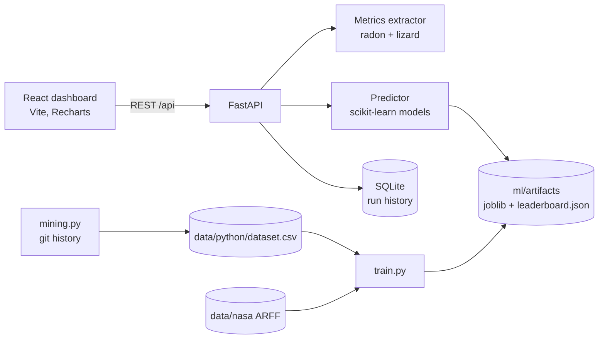

# Architecture

## Components

| Component | Location | Responsibility |
|---|---|---|
| Metrics extractor | `backend/app/metrics/extractor.py` | Splits source into functions with lizard, computes token-based Halstead, LOC, comment %, parameters, plus file-level maintainability index (radon). |
| Predictor | `backend/app/ml/predict.py` | Loads a model family, scores functions, flags anomalies, computes per-function drivers. |
| Training | `backend/app/ml/train.py` | Benchmarks seven models per family with grouped, cross-project and temporal evaluation; writes models and `leaderboard.json`. |
| Mining | `backend/app/ml/mining.py` | Builds the Python-native dataset from git history. |
| Dataset analysis | `backend/app/ml/eda.py` | Distributions, correlations and defect rate by bin, served to the Insights page. |
| API | `backend/app/main.py` | REST endpoints, upload validation (zip size, zip-slip guard). |
| Store | `backend/app/store.py` | SQLite persistence for runs. |
| Dashboard | `frontend/src` | Overview, analysis, results explorer, code health, insights, models, report, history, settings. |

## Data flow for one analysis

1. The client posts a zip, snippet or demo request with a model family and optional model.
2. The API extracts the archive into a temp directory (size-limited, path-checked) and the extractor walks supported source files.
3. Every function is scored by the chosen model. Probabilities are calibrated; risk levels are relative to the family's out-of-fold score distribution (top 5% high, next 10% medium).
4. The run (summary plus per-function results) is stored in SQLite and returned.
5. The dashboard derives all charts and tables client-side from the stored run, so history can be reopened and compared.

## Design decisions

- **Feature parity between training and inference.** The mined dataset is built with the same extractor the app uses, so there is no train/serve skew. (An earlier NASA-only version had a language mismatch.)
- **Token-based Halstead.** radon's AST-based Halstead undercounts and returns zero for many functions, which pushed Python far outside the training distribution.
- **Two model families.** `python` is the default; `nasa` is a published benchmark kept for comparison. Artifacts live in `ml/artifacts/<family>/` and each run records the family that scored it.
- **Simple default model.** Logistic regression ties the best cross-repo AUC, is calibrated, and powers the per-function explanations (coefficient x standardised value).
- **Relative risk levels.** A fixed probability cut-off would never fire on a 2.8% base rate, so thresholds are quantiles of out-of-fold scores and are editable in Settings.
- **Anomalies are relative.** Real code sits off any training distribution, so the most unusual ~5% of each run is flagged rather than using an absolute cutoff.
