# Application walkthrough

Every page of CodeSentinel, captured from the running application with the [sample projects](../samples/README.md). Red numbered markers on a screenshot correspond to the rows of the table beneath it. The same material, with commentary, is in the [project report](report/CodeSentinel_Project_Report.pdf).

Contents: [Application shell and navigation](#application-shell-and-navigation) · [New analysis](#new-analysis) · [Overview](#overview) · [Results explorer](#results-explorer) · [Code health](#code-health) · [Insights](#insights) · [Models](#models) · [Report](#report) · [History and run comparison](#history-and-run-comparison) · [Settings and themes](#settings-and-themes) · [Same project, different model and family](#same-project-different-model-and-family) · [Overview of every sample project](#overview-of-every-sample-project)

## Application shell and navigation

The sidebar groups the pages into Workspace, Intelligence and System; the top bar names the page, opens the command palette, switches between saved runs, shows the active model and toggles the theme. On a phone-width screen the sidebar becomes a slide-in menu.

### Empty state before any analysis

Overview with no analysis yet: every page shows a prompt that points to New analysis.

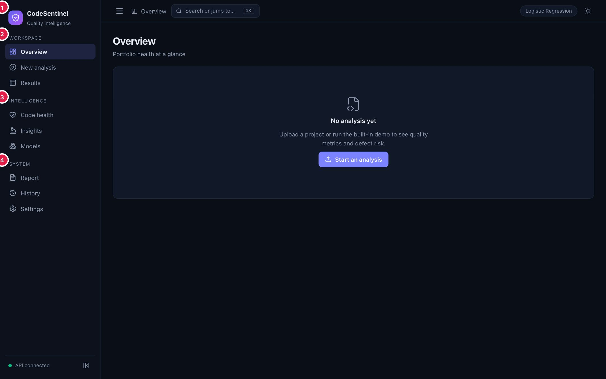

| No. | Element | What it shows |
|---|---|---|
| 1 | **Brand and API status** | Application name; the status dot at the bottom of the sidebar shows whether the API is connected. |
| 2 | **Workspace pages** | Overview, New analysis and Results (the badge counts high-risk functions). |
| 3 | **Intelligence pages** | Code health, Insights and Models. |
| 4 | **System pages** | Report, History and Settings. |

### Application shell

The persistent frame: sidebar navigation on the left and the top bar with page name, command palette, run selector, active model and theme toggle.

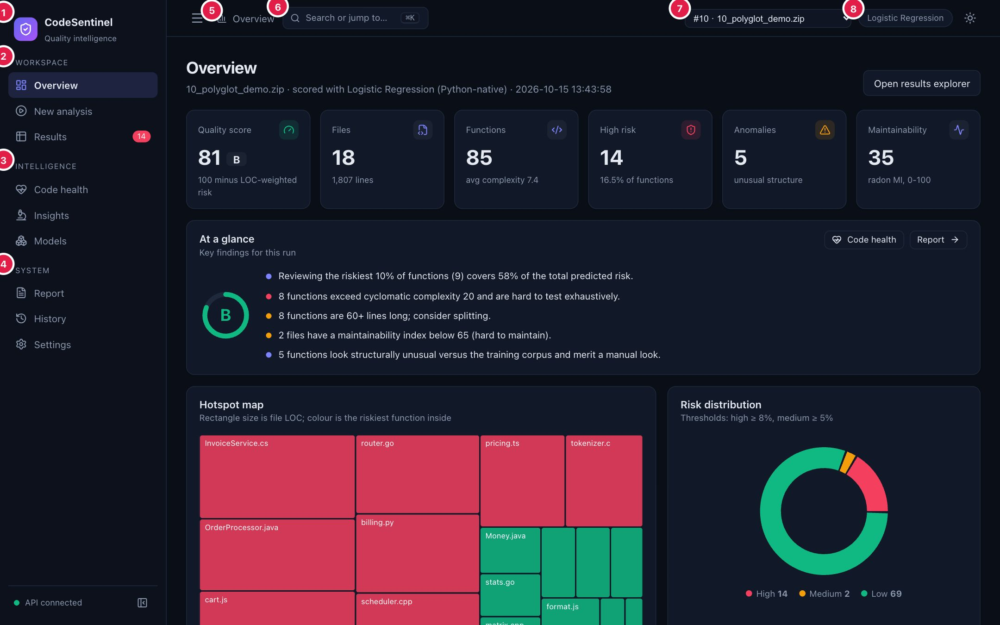

| No. | Element | What it shows |
|---|---|---|
| 1 | **Brand and API status** | Application name; the status dot at the bottom of the sidebar shows whether the API is connected. |
| 2 | **Workspace pages** | Overview, New analysis and Results (the badge counts high-risk functions). |
| 3 | **Intelligence pages** | Code health, Insights and Models. |
| 4 | **System pages** | Report, History and Settings. |
| 5 | **Current page** | Name of the page being viewed. |
| 6 | **Command palette** | Opens the page switcher; the shortcut is Ctrl or Cmd plus K. |
| 7 | **Run selector** | Switch the whole app to any saved analysis run. |
| 8 | **Active model** | The model that scores new analyses. |

### Command palette

Pressing Ctrl or Cmd plus K opens a searchable list of pages; typing filters it and Enter jumps there.

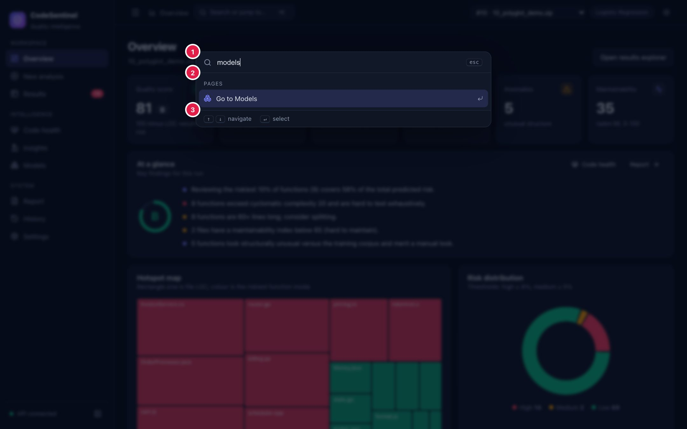

| No. | Element | What it shows |
|---|---|---|
| 1 | **Search field** | Type to filter pages; here 'models' is typed. |
| 2 | **Matching pages** | The highlighted entry is opened by pressing Enter; arrow keys move the highlight. |
| 3 | **Key hints** | Arrow keys navigate, Enter selects, Escape closes. |

### Responsive layout (phone width)

At phone width the sidebar collapses behind a menu button and panels stack in one column.

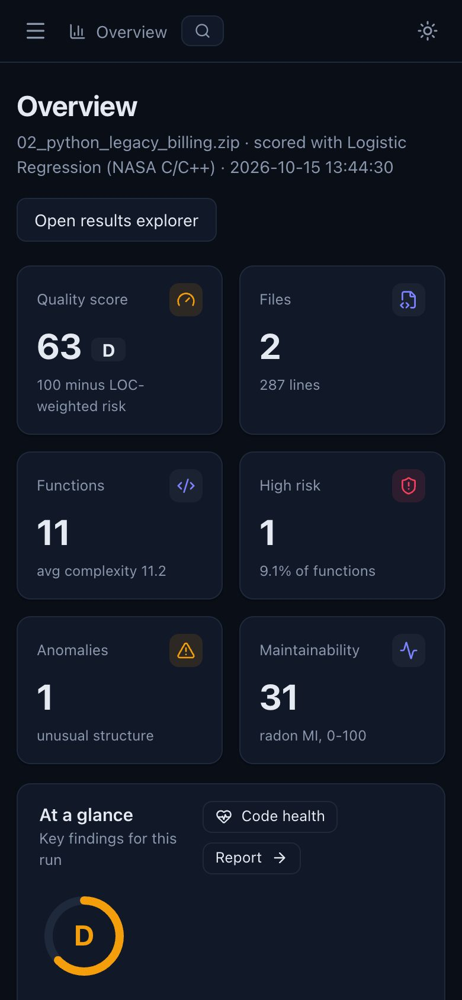

### Responsive layout: navigation menu

The menu button opens the same navigation as a slide-in panel.

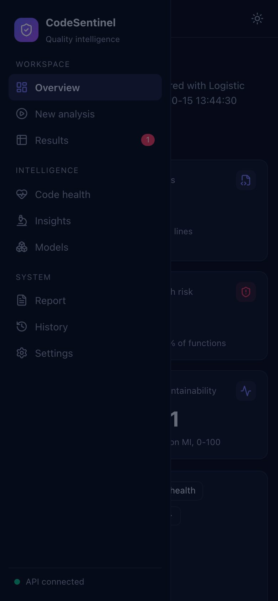

## New analysis

Upload a zip, paste a single file or run the built-in demo, then pick the model family and algorithm. Input is validated before a run is created; errors are shown and nothing is saved.

### New analysis: Upload project

Drag a zip onto the drop area or click it to browse. The right-hand panels choose the model family and model.

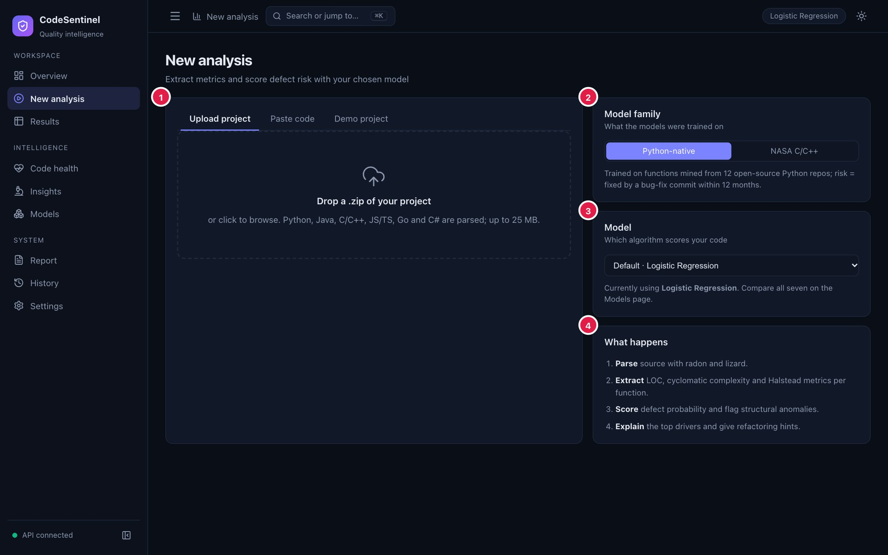

| No. | Element | What it shows |
|---|---|---|
| 1 | **Drop a .zip of your project** |  |
| 2 | **Model family** | Choose the Python-native or the NASA C/C++ model family for the next analysis. |
| 3 | **Model** | Choose which of the seven algorithms scores the code. |
| 4 | **What happens** | The four processing steps: parse, extract, score, explain. |

### New analysis: Paste code

Paste a single file and give it a file name; the extension selects the language parser.

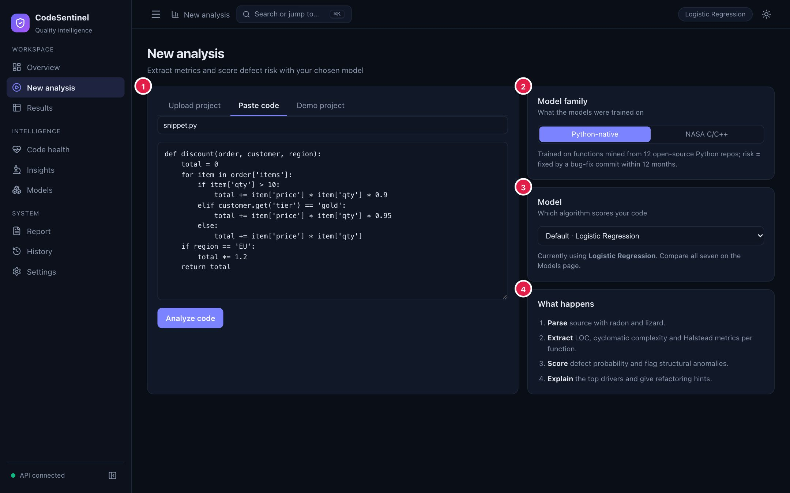

| No. | Element | What it shows |
|---|---|---|
| 1 | **Code editor** |  |
| 2 | **Model family** | Choose the Python-native or the NASA C/C++ model family for the next analysis. |
| 3 | **Model** | Choose which of the seven algorithms scores the code. |
| 4 | **What happens** | The four processing steps: parse, extract, score, explain. |

### New analysis: Demo project

One click analyses part of the CPython standard library with no upload needed.

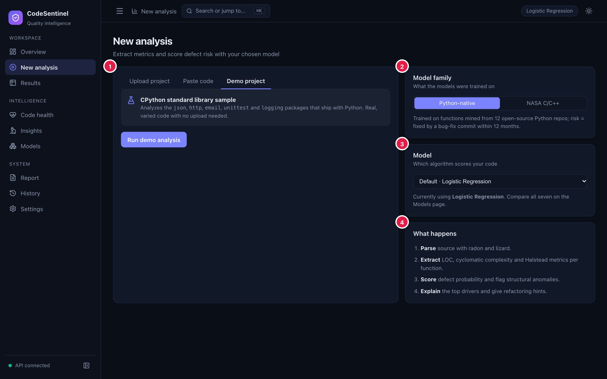

| No. | Element | What it shows |
|---|---|---|
| 1 | **Panel** |  |
| 2 | **Model family** | Choose the Python-native or the NASA C/C++ model family for the next analysis. |
| 3 | **Model** | Choose which of the seven algorithms scores the code. |
| 4 | **What happens** | The four processing steps: parse, extract, score, explain. |

### Model family switched to NASA C/C++

Selecting the NASA family changes the description and the list of available models (RBF-SVM replaces the linear SVM).

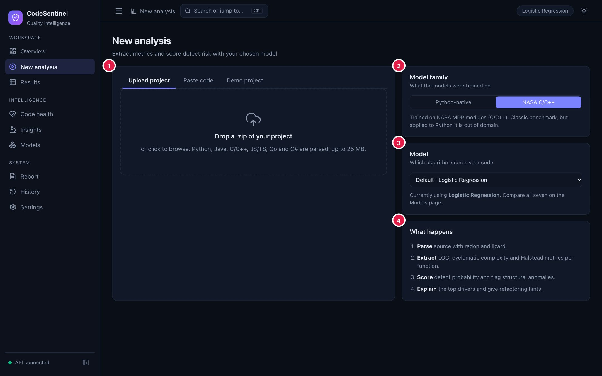

| No. | Element | What it shows |
|---|---|---|
| 1 | **Drop a .zip of your project** |  |
| 2 | **Model family** | Choose the Python-native or the NASA C/C++ model family for the next analysis. |
| 3 | **Model** | Choose which of the seven algorithms scores the code. |
| 4 | **What happens** | The four processing steps: parse, extract, score, explain. |

### Error: not a zip file

Uploading a file that is not a zip archive is rejected with a clear message.

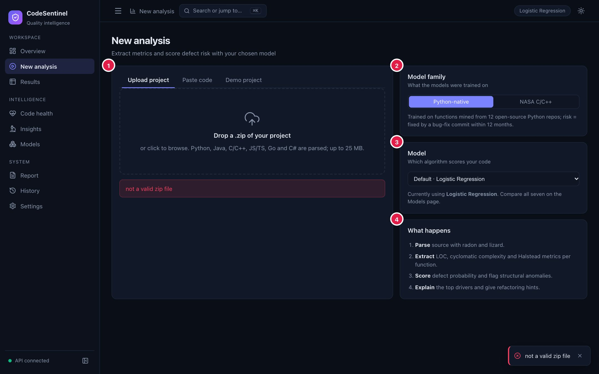

| No. | Element | What it shows |
|---|---|---|
| 1 | **Drop a .zip of your project** |  |
| 2 | **Model family** | Choose the Python-native or the NASA C/C++ model family for the next analysis. |
| 3 | **Model** | Choose which of the seven algorithms scores the code. |
| 4 | **What happens** | The four processing steps: parse, extract, score, explain. |

### Error: no supported source files

A zip with no supported source files is rejected instead of producing an empty run.

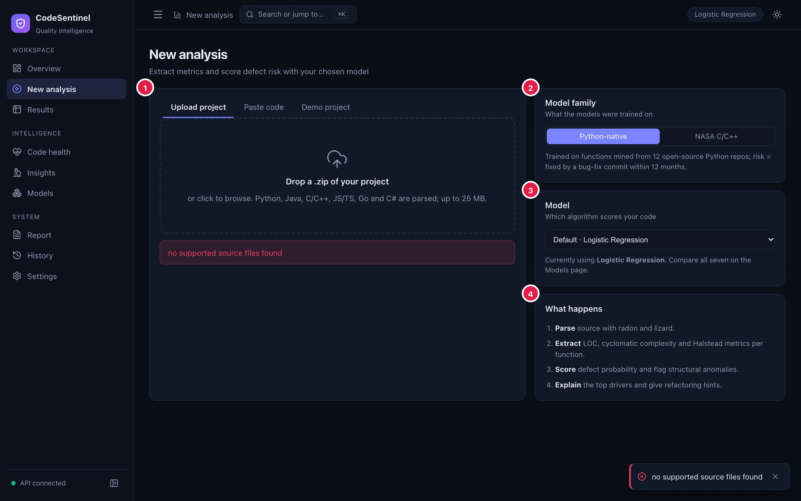

| No. | Element | What it shows |
|---|---|---|
| 1 | **Drop a .zip of your project** |  |
| 2 | **Model family** | Choose the Python-native or the NASA C/C++ model family for the next analysis. |
| 3 | **Model** | Choose which of the seven algorithms scores the code. |
| 4 | **What happens** | The four processing steps: parse, extract, score, explain. |

## Overview

Quality score and grade, headline counts, plain-language findings, a hotspot map, the risk distribution, the riskiest functions and the average risk per directory.

### Overview page

Overview of the 18-file polyglot project.

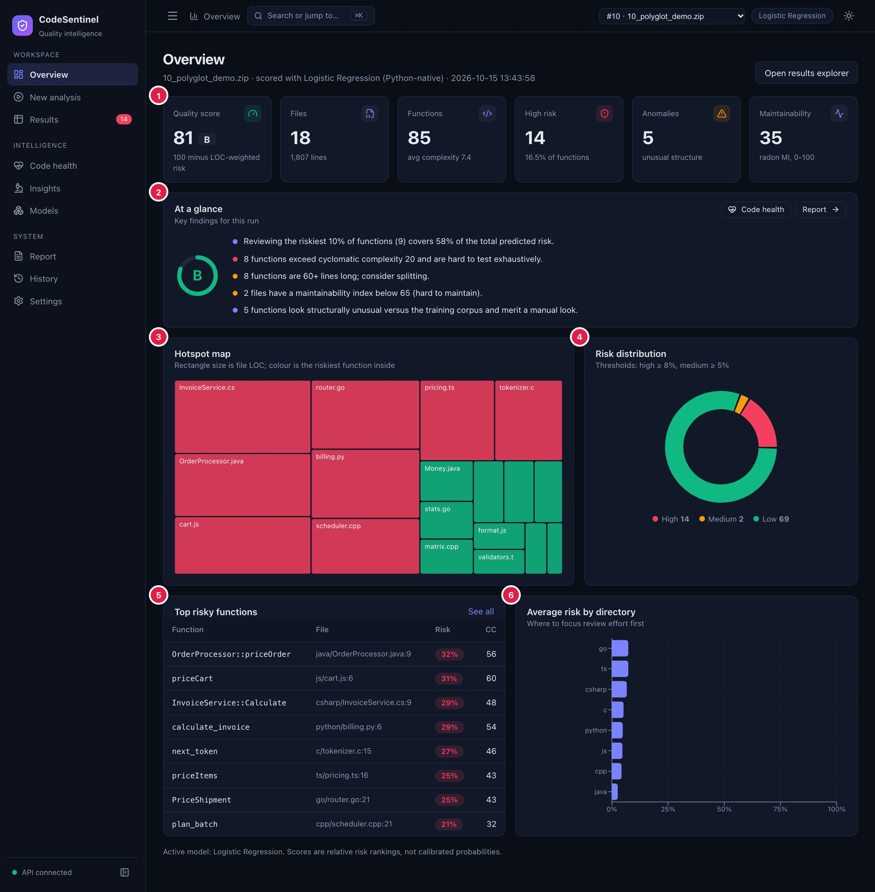

| No. | Element | What it shows |
|---|---|---|
| 1 | **KPI cards** |  |
| 2 | **At a glance** | Plain-language findings for the run: how much risk sits in the riskiest 10% of functions, how many functions are very complex or long, files with low maintainability and structurally unusual functions, plus the A to F quality grade. |
| 3 | **Hotspot map** | Treemap of files. Rectangle size is the file's lines of code and colour is the highest risk of any function inside it (red high, amber medium, green low). |
| 4 | **Risk distribution** | Share of functions at each risk level, using the calibrated thresholds shown in the panel subtitle. |
| 5 | **Top risky functions** | The eight highest-risk functions with file, line, predicted defect probability and cyclomatic complexity. 'See all' opens the Results page. |
| 6 | **Average risk by directory** | Mean predicted risk of the functions in each folder, to decide which part of the code base to review first. |

## Results explorer

Every function in a searchable, sortable, filterable table, plus a file-level tab. A detail drawer explains each score with a calibrated risk gauge, metric percentiles, the three drivers and refactoring hints.

### Results: Functions tab

Every function of the run in a searchable, sortable table (default sort: highest risk first).

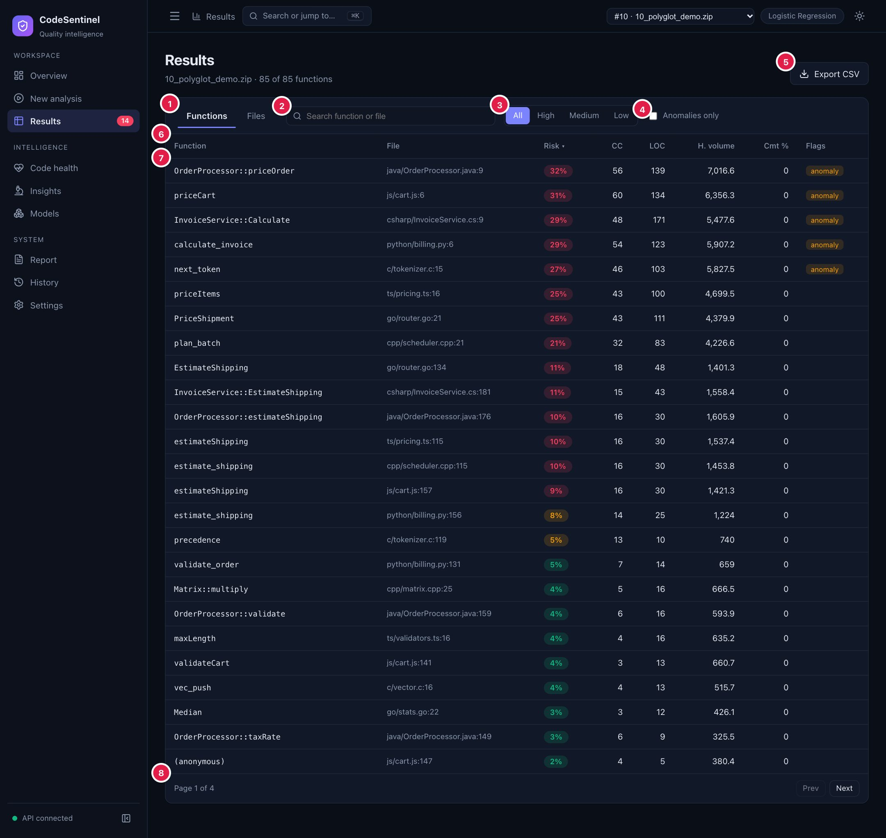

| No. | Element | What it shows |
|---|---|---|
| 1 | **Functions / Files tabs** | Switch between the function table and the file-level table. |
| 2 | **Search box** | Filters by function name or file path as you type. |
| 3 | **Risk filter** | Show all functions or only high, medium or low risk. |
| 4 | **Anomalies only** | Limit the table to functions flagged as structurally unusual. |
| 5 | **Export CSV** | Download the currently filtered rows as a CSV file. |
| 6 | **Column headers** | Click a header to sort by that column; the arrow shows the sort direction. |
| 7 | **Function row** | Click a row to open the detail drawer for that function. |
| 8 | **Pager** | Moves through the results 25 rows at a time. |

### Results filtered to high risk

The risk filter set to High leaves only the functions above the high threshold.

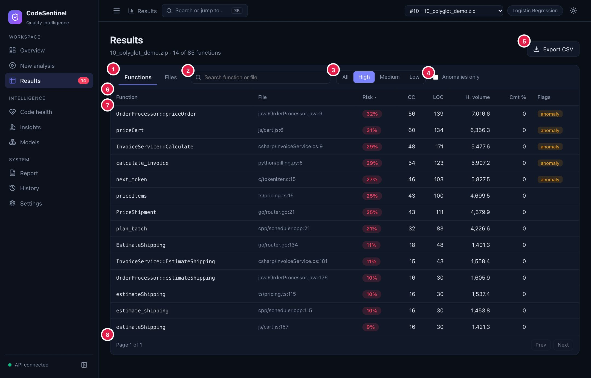

| No. | Element | What it shows |
|---|---|---|
| 1 | **Functions / Files tabs** | Switch between the function table and the file-level table. |
| 2 | **Search box** | Filters by function name or file path as you type. |
| 3 | **Risk filter** | Show all functions or only high, medium or low risk. |
| 4 | **Anomalies only** | Limit the table to functions flagged as structurally unusual. |
| 5 | **Export CSV** | Download the currently filtered rows as a CSV file. |
| 6 | **Column headers** | Click a header to sort by that column; the arrow shows the sort direction. |
| 7 | **Function row** | Click a row to open the detail drawer for that function. |
| 8 | **Pager** | Moves through the results 25 rows at a time. |

### Results filtered to anomalies

The Anomalies only checkbox shows the structurally unusual functions flagged by the Isolation Forest.

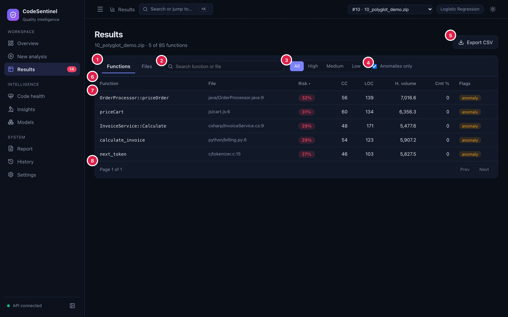

| No. | Element | What it shows |
|---|---|---|
| 1 | **Functions / Files tabs** | Switch between the function table and the file-level table. |
| 2 | **Search box** | Filters by function name or file path as you type. |
| 3 | **Risk filter** | Show all functions or only high, medium or low risk. |
| 4 | **Anomalies only** | Limit the table to functions flagged as structurally unusual. |
| 5 | **Export CSV** | Download the currently filtered rows as a CSV file. |
| 6 | **Column headers** | Click a header to sort by that column; the arrow shows the sort direction. |
| 7 | **Function row** | Click a row to open the detail drawer for that function. |
| 8 | **Pager** | Moves through the results 25 rows at a time. |

### Results with a search term

Searching for 'estimate' filters function and file names; the match count is in the page subtitle.

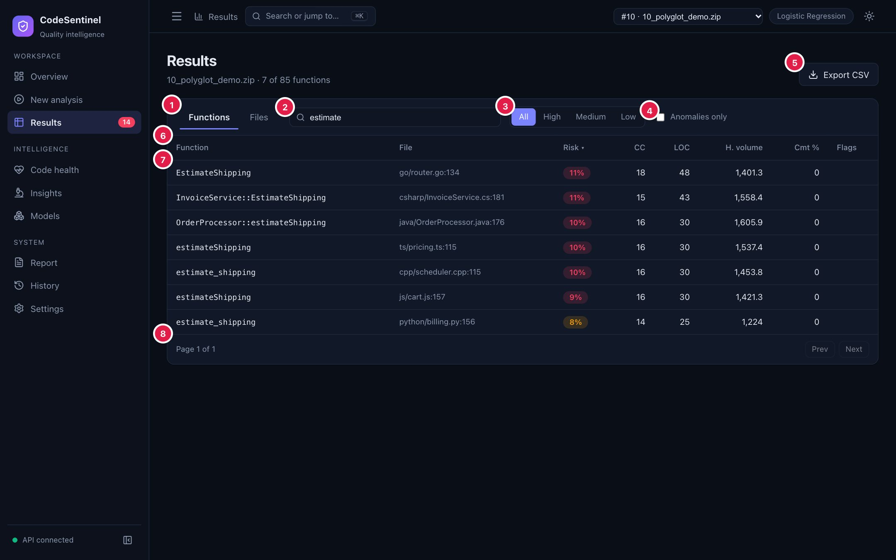

| No. | Element | What it shows |
|---|---|---|
| 1 | **Functions / Files tabs** | Switch between the function table and the file-level table. |
| 2 | **Search box** | Filters by function name or file path as you type. |
| 3 | **Risk filter** | Show all functions or only high, medium or low risk. |
| 4 | **Anomalies only** | Limit the table to functions flagged as structurally unusual. |
| 5 | **Export CSV** | Download the currently filtered rows as a CSV file. |
| 6 | **Column headers** | Click a header to sort by that column; the arrow shows the sort direction. |
| 7 | **Function row** | Click a row to open the detail drawer for that function. |
| 8 | **Pager** | Moves through the results 25 rows at a time. |

### Results: Files tab

File-level view with maximum function risk, lines, function count, maximum complexity and maintainability index; clicking a file filters the functions tab.

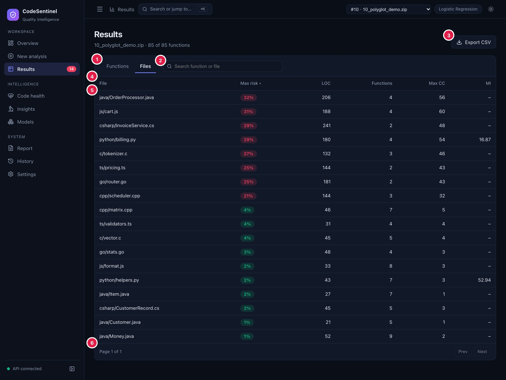

| No. | Element | What it shows |
|---|---|---|
| 1 | **Functions / Files tabs** | Switch between the function table and the file-level table. |
| 2 | **Search box** | Filters by function name or file path as you type. |
| 3 | **Export CSV** | Download the currently filtered rows as a CSV file. |
| 4 | **Column headers** | Click a header to sort by that column; the arrow shows the sort direction. |
| 5 | **Function row** | Click a row to open the detail drawer for that function. |
| 6 | **Pager** | Moves through the results 25 rows at a time. |

### Function detail: Java

Detail drawer for the Java OrderProcessor::priceOrder method: calibrated risk gauge, metric percentiles, score drivers and refactoring hints.

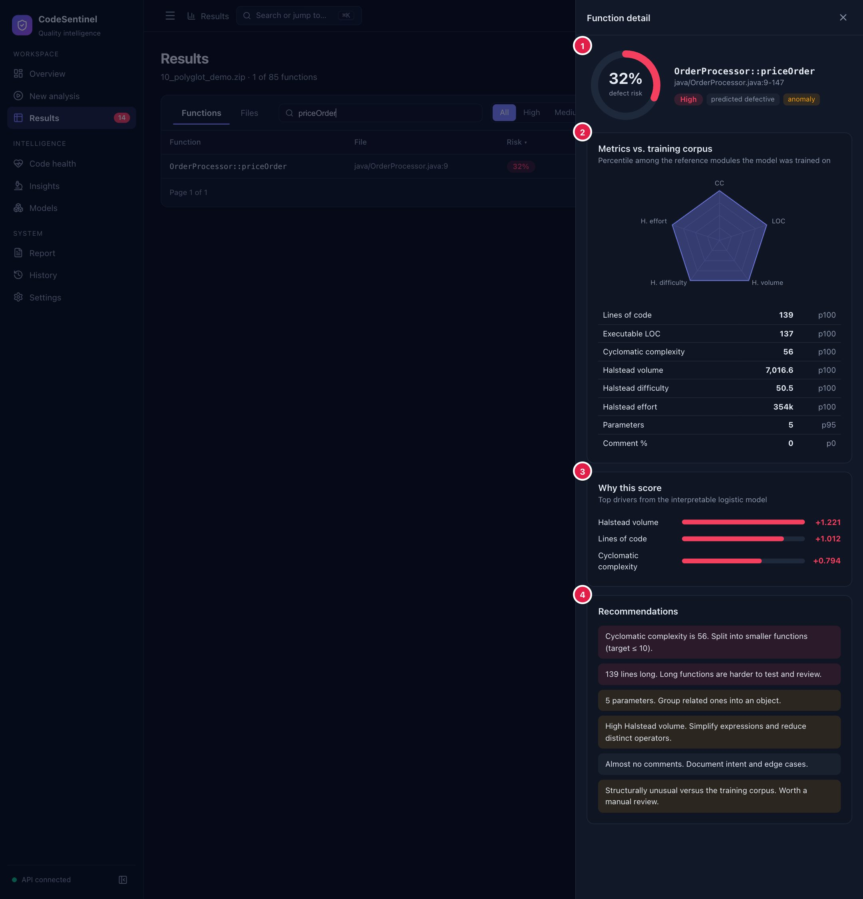

| No. | Element | What it shows |
|---|---|---|
| 1 | **Header** | Risk gauge with the calibrated probability, function name and location, risk level, predicted label and anomaly flag. |
| 2 | **Metrics vs. training corpus** | Radar and table of the function's metrics with their percentile among the training functions. |
| 3 | **Why this score** | Top three drivers from the interpretable logistic model; red bars raise risk, green bars lower it. |
| 4 | **Recommendations** | Rule-based refactoring hints for this function. |

### Function detail: C

Detail drawer for the C tokenizer function (deep nesting and many parameters).

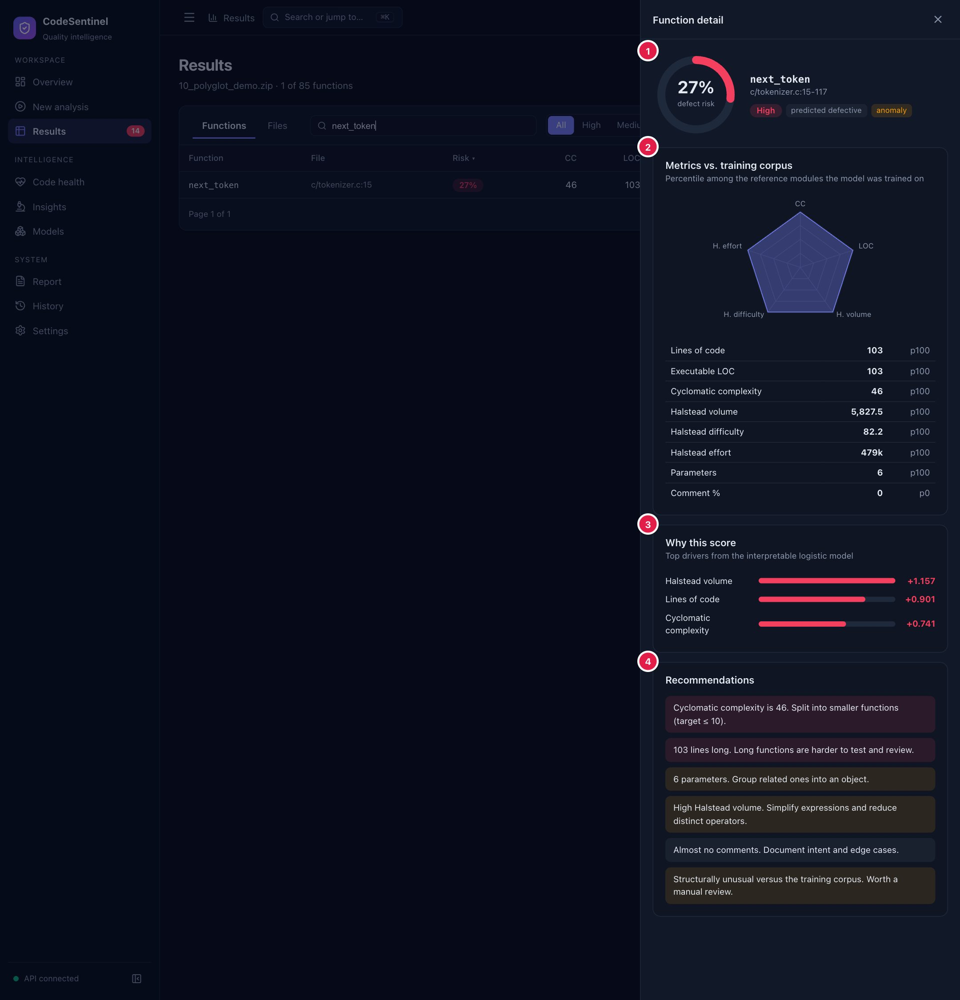

| No. | Element | What it shows |
|---|---|---|
| 1 | **Header** | Risk gauge with the calibrated probability, function name and location, risk level, predicted label and anomaly flag. |
| 2 | **Metrics vs. training corpus** | Radar and table of the function's metrics with their percentile among the training functions. |
| 3 | **Why this score** | Top three drivers from the interpretable logistic model; red bars raise risk, green bars lower it. |
| 4 | **Recommendations** | Rule-based refactoring hints for this function. |

### Function detail: Go

Detail drawer for the Go PriceShipment function.

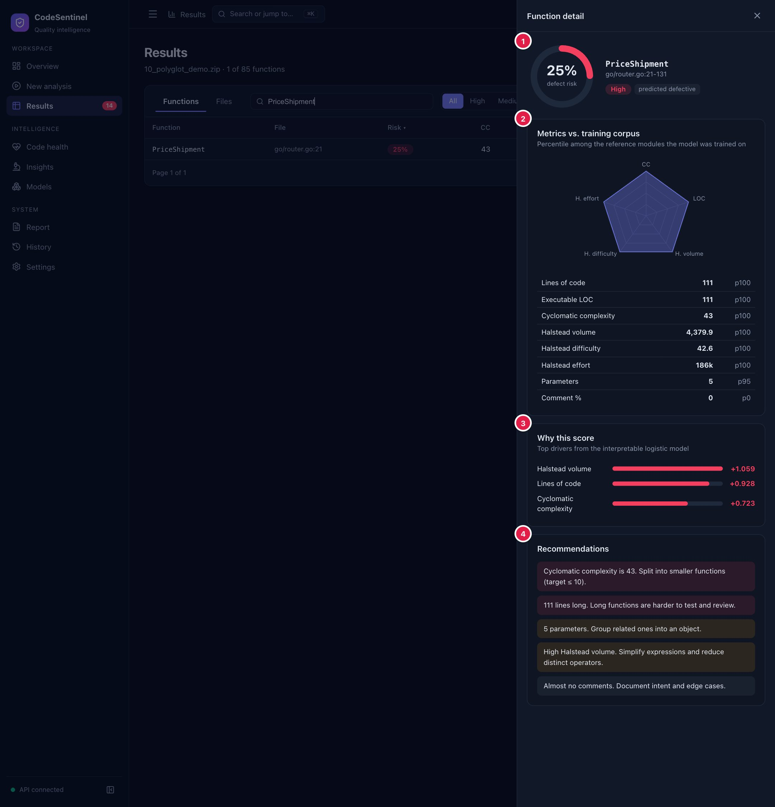

| No. | Element | What it shows |
|---|---|---|
| 1 | **Header** | Risk gauge with the calibrated probability, function name and location, risk level, predicted label and anomaly flag. |
| 2 | **Metrics vs. training corpus** | Radar and table of the function's metrics with their percentile among the training functions. |
| 3 | **Why this score** | Top three drivers from the interpretable logistic model; red bars raise risk, green bars lower it. |
| 4 | **Recommendations** | Rule-based refactoring hints for this function. |

### Function detail: C#

Detail drawer for the C# InvoiceService::Calculate method.

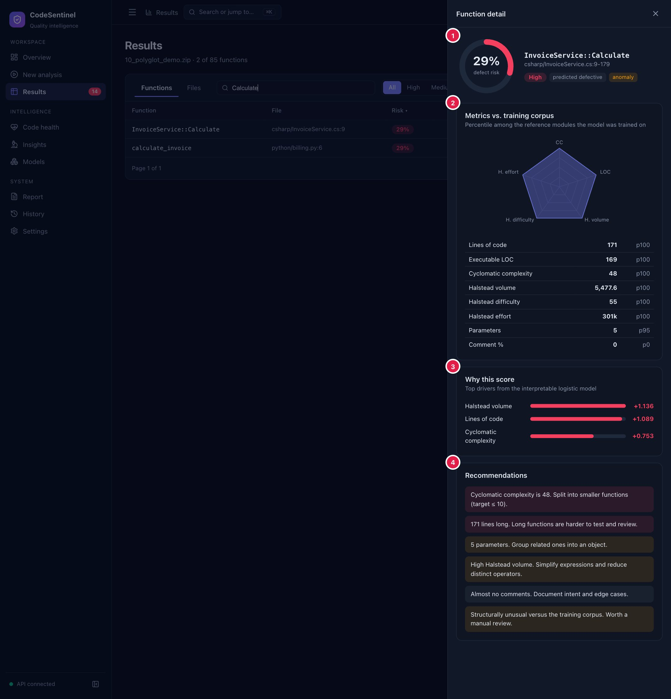

| No. | Element | What it shows |
|---|---|---|
| 1 | **Header** | Risk gauge with the calibrated probability, function name and location, risk level, predicted label and anomaly flag. |
| 2 | **Metrics vs. training corpus** | Radar and table of the function's metrics with their percentile among the training functions. |
| 3 | **Why this score** | Top three drivers from the interpretable logistic model; red bars raise risk, green bars lower it. |
| 4 | **Recommendations** | Rule-based refactoring hints for this function. |

### Function detail: Python

Detail drawer for the Python calculate_invoice function, including comment percentage which is measured for Python only.

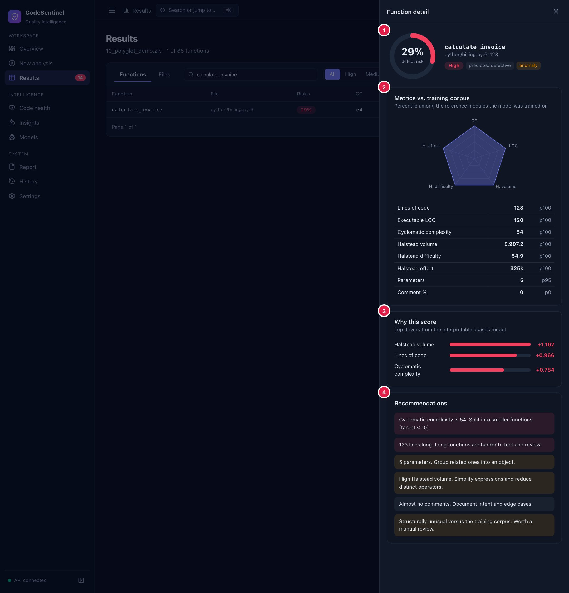

| No. | Element | What it shows |
|---|---|---|
| 1 | **Header** | Risk gauge with the calibrated probability, function name and location, risk level, predicted label and anomaly flag. |
| 2 | **Metrics vs. training corpus** | Radar and table of the function's metrics with their percentile among the training functions. |
| 3 | **Why this score** | Top three drivers from the interpretable logistic model; red bars raise risk, green bars lower it. |
| 4 | **Recommendations** | Rule-based refactoring hints for this function. |

### Function detail: a low-risk function

A small helper scores low and the recommendations panel reports no structural red flags.

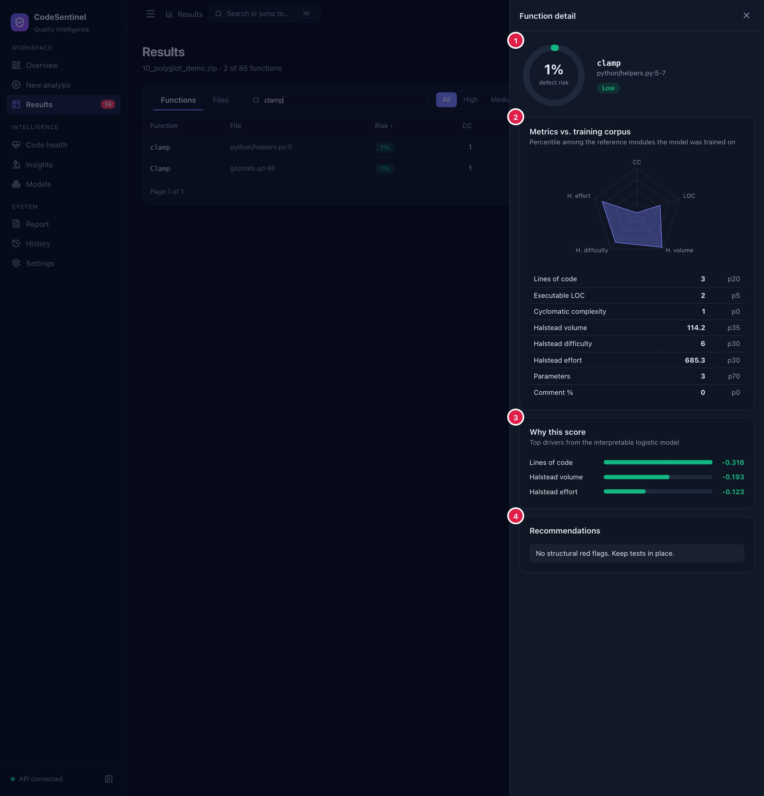

| No. | Element | What it shows |
|---|---|---|
| 1 | **Header** | Risk gauge with the calibrated probability, function name and location, risk level, predicted label and anomaly flag. |
| 2 | **Metrics vs. training corpus** | Radar and table of the function's metrics with their percentile among the training functions. |
| 3 | **Why this score** | Top three drivers from the interpretable logistic model; red bars raise risk, green bars lower it. |
| 4 | **Recommendations** | Rule-based refactoring hints for this function. |

## Code health

Review-effort curve, complexity bands, a profile against the training corpus, maintainability, comment density, a file bubble chart and a hotspot matrix.

### Code health: polyglot project

Deep dive into complexity, maintainability and review effort for the polyglot project.

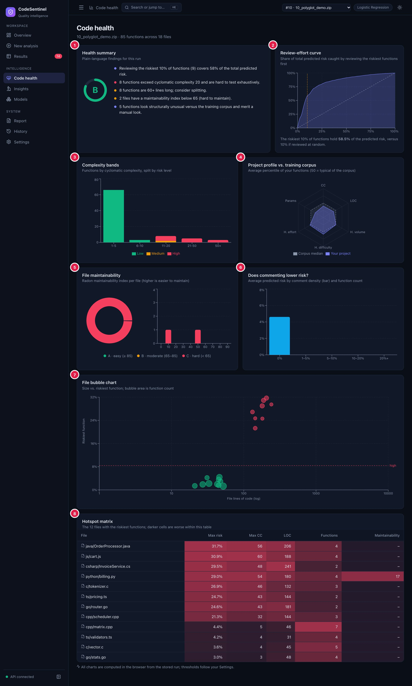

| No. | Element | What it shows |
|---|---|---|
| 1 | **Health summary** | The same plain-language findings as the Overview, with the quality grade ring. |
| 2 | **Review-effort curve** | Share of the total predicted risk captured when functions are reviewed from riskiest to least risky. The dashed diagonal is random review; the dotted marker is the riskiest 10%. |
| 3 | **Complexity bands** | Number of functions in each cyclomatic-complexity band, stacked by risk level. |
| 4 | **Project profile vs. training corpus** | Radar of the average percentile of this project's functions against the training corpus (50 is typical). |
| 5 | **File maintainability** | Radon maintainability index per file (higher is easier to maintain). Available for Python files only. |
| 6 | **Does commenting lower risk?** | Average predicted risk by comment density (bars) with the number of functions in each band. |
| 7 | **File bubble chart** | Each bubble is a file: horizontal position is size, vertical position is the riskiest function, bubble area is the function count. |
| 8 | **Hotspot matrix** | The 12 files with the riskiest functions as a heat table of size, complexity, length and risk. |

### Code health: clean toolkit

The same page for the clean Python toolkit: complexity bands are all low and the review-effort curve is nearly flat.

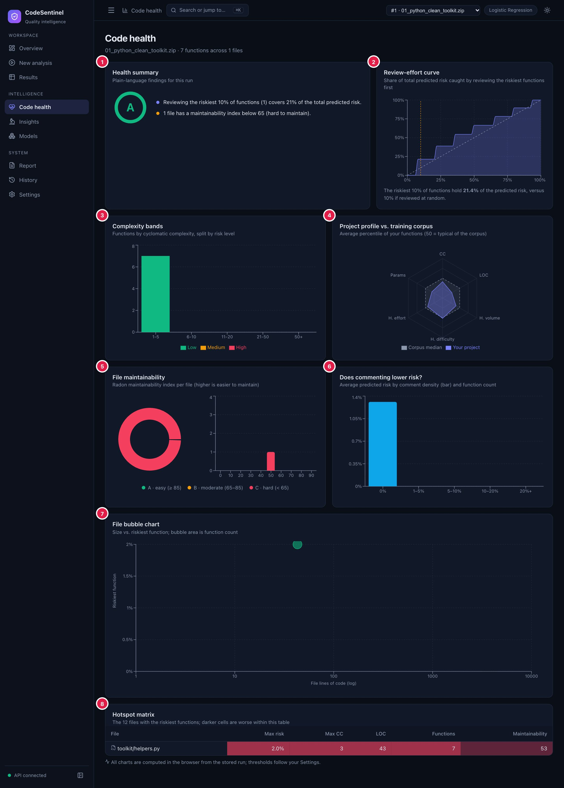

| No. | Element | What it shows |
|---|---|---|
| 1 | **Health summary** | The same plain-language findings as the Overview, with the quality grade ring. |
| 2 | **Review-effort curve** | Share of the total predicted risk captured when functions are reviewed from riskiest to least risky. The dashed diagonal is random review; the dotted marker is the riskiest 10%. |
| 3 | **Complexity bands** | Number of functions in each cyclomatic-complexity band, stacked by risk level. |
| 4 | **Project profile vs. training corpus** | Radar of the average percentile of this project's functions against the training corpus (50 is typical). |
| 5 | **File maintainability** | Radon maintainability index per file (higher is easier to maintain). Available for Python files only. |
| 6 | **Does commenting lower risk?** | Average predicted risk by comment density (bars) with the number of functions in each band. |
| 7 | **File bubble chart** | Each bubble is a file: horizontal position is size, vertical position is the riskiest function, bubble area is the function count. |
| 8 | **Hotspot matrix** | The 12 files with the riskiest functions as a heat table of size, complexity, length and risk. |

### Code health: legacy billing

The legacy billing project: a single function holds most of the predicted risk, so the review-effort curve rises steeply.

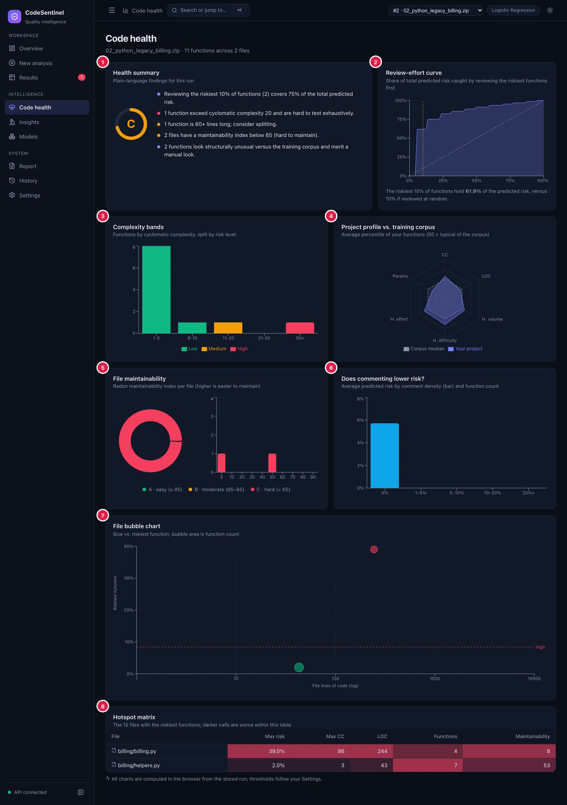

| No. | Element | What it shows |
|---|---|---|
| 1 | **Health summary** | The same plain-language findings as the Overview, with the quality grade ring. |
| 2 | **Review-effort curve** | Share of the total predicted risk captured when functions are reviewed from riskiest to least risky. The dashed diagonal is random review; the dotted marker is the riskiest 10%. |
| 3 | **Complexity bands** | Number of functions in each cyclomatic-complexity band, stacked by risk level. |
| 4 | **Project profile vs. training corpus** | Radar of the average percentile of this project's functions against the training corpus (50 is typical). |
| 5 | **File maintainability** | Radon maintainability index per file (higher is easier to maintain). Available for Python files only. |
| 6 | **Does commenting lower risk?** | Average predicted risk by comment density (bars) with the number of functions in each band. |
| 7 | **File bubble chart** | Each bubble is a file: horizontal position is size, vertical position is the riskiest function, bubble area is the function count. |
| 8 | **Hotspot matrix** | The 12 files with the riskiest functions as a heat table of size, complexity, length and risk. |

## Insights

What the training data says about metrics and defects (defect rate by complexity, length and repository; distributions; correlations) plus the profile of the loaded project.

### Insights: Defect drivers

What the 50,826 mined functions say about metrics and defects.

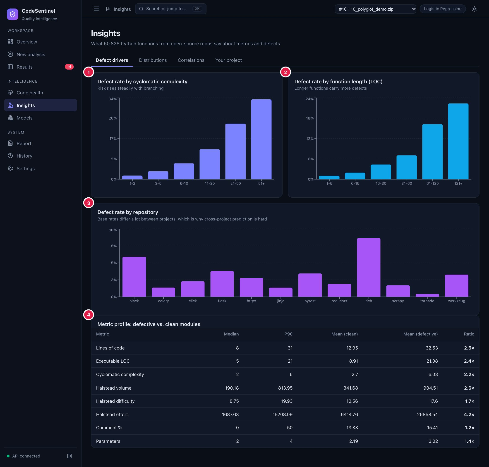

| No. | Element | What it shows |
|---|---|---|
| 1 | **Defect rate by cyclomatic complexity** | Share of functions in the training data that were later fixed for a bug, by complexity band. Risk rises steadily with branching. |
| 2 | **Defect rate by function length (LOC)** | The same defect rate by function length band. Longer functions carry more defects. |
| 3 | **Defect rate by repository** | Base defect rate of each mined repository; base rates differ widely, which is why cross-project prediction is hard. |
| 4 | **Metric profile: defective vs. clean modules** | Median, 90th percentile and class means of every metric for clean versus defective training functions, with the ratio between them. |

### Insights: Distributions (cyclomatic complexity)

Histogram of cyclomatic complexity for clean and defective functions.

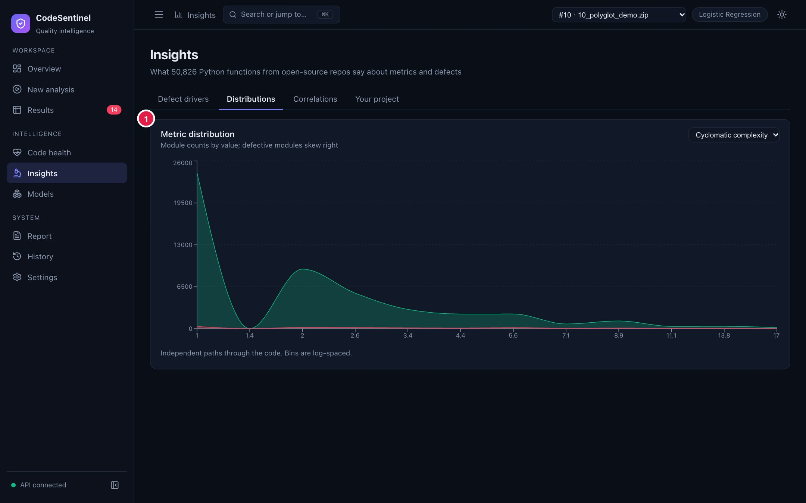

| No. | Element | What it shows |
|---|---|---|
| 1 | **Metric distribution** | Histogram of one metric (chosen in the drop-down) for clean and defective training functions, on log-spaced bins. |

### Insights: Distributions (Halstead volume)

The metric drop-down switches the histogram, here to Halstead volume.

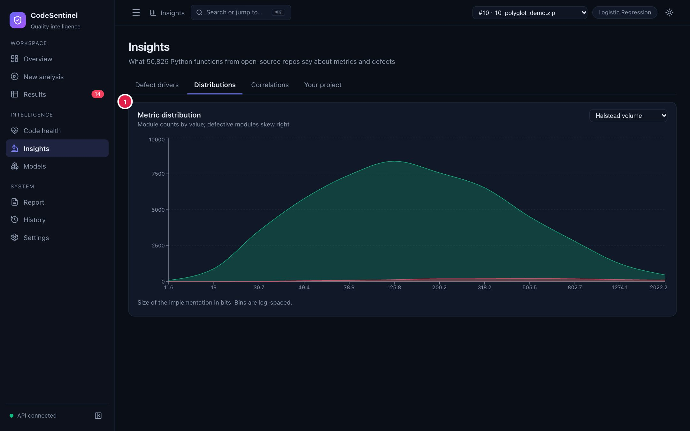

| No. | Element | What it shows |
|---|---|---|
| 1 | **Metric distribution** | Histogram of one metric (chosen in the drop-down) for clean and defective training functions, on log-spaced bins. |

### Insights: Correlations

Spearman correlation matrix of all metrics with the defect label, and each metric's correlation with defects.

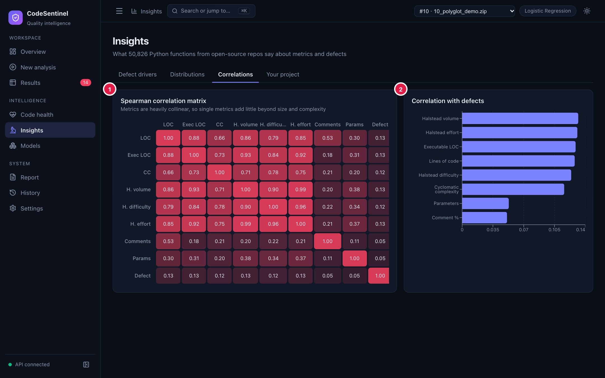

| No. | Element | What it shows |
|---|---|---|
| 1 | **Spearman correlation matrix** | Rank correlation between all metrics and the defect label. Metrics are strongly collinear. |
| 2 | **Correlation with defects** | Correlation of each individual metric with the defect label. |

### Insights: Your project

Metric profile of the currently loaded run.

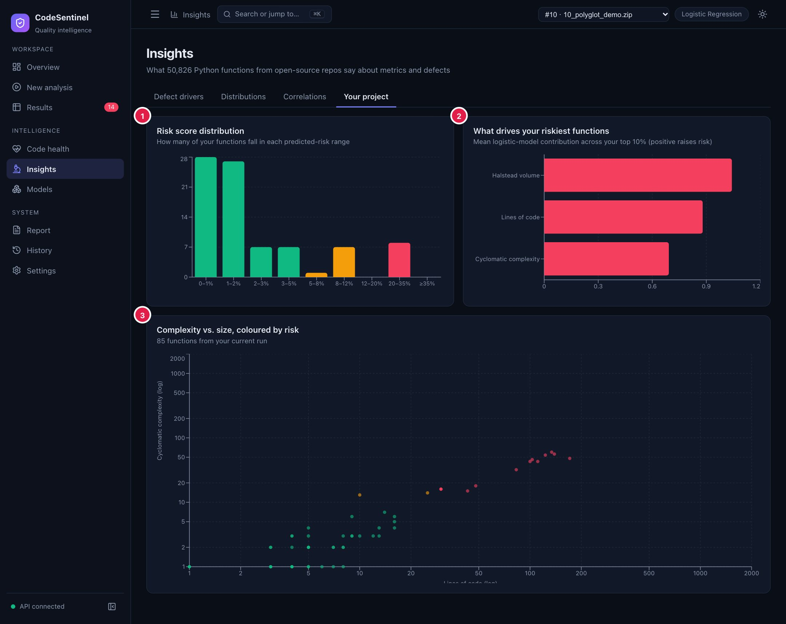

| No. | Element | What it shows |
|---|---|---|
| 1 | **Risk score distribution** | How many of this project's functions fall in each predicted-risk range. |
| 2 | **What drives your riskiest functions** | Mean logistic-model contribution of each metric across the project's riskiest 10% of functions (positive raises risk). |
| 3 | **Complexity vs. size, coloured by risk** | Scatter of every function: lines of code against cyclomatic complexity, coloured by risk level. |

### Insights: NASA family

Dataset analysis for the NASA family: defect rate by complexity and length in C/C++ modules.

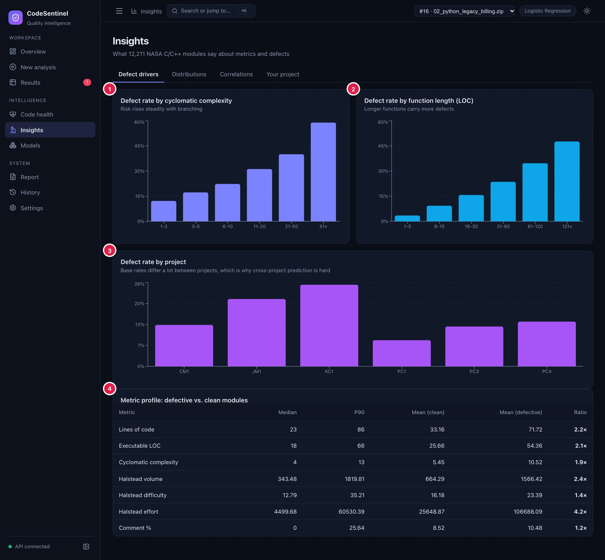

| No. | Element | What it shows |
|---|---|---|
| 1 | **Defect rate by cyclomatic complexity** | Share of functions in the training data that were later fixed for a bug, by complexity band. Risk rises steadily with branching. |
| 2 | **Defect rate by function length (LOC)** | The same defect rate by function length band. Longer functions carry more defects. |
| 3 | **Defect rate by project** | Base defect rate of each NASA project in the benchmark data. |
| 4 | **Metric profile: defective vs. clean modules** | Median, 90th percentile and class means of every metric for clean versus defective training functions, with the ratio between them. |

## Models

Leaderboard for cross-repository, within-repository and temporal evaluation, ROC curves, confusion matrix, feature importance, per-repository AUC and model agreement.

### Models: Leaderboard (cross-repository)

Seven models ranked by mean AUC when each repository is held out in turn.

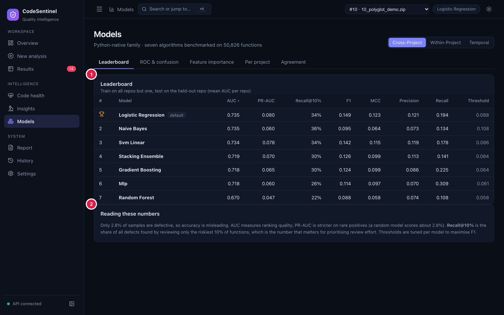

| No. | Element | What it shows |
|---|---|---|
| 1 | **Leaderboard** | All seven models ranked by the selected evaluation, with AUC, PR-AUC, recall at the top 10%, F1, MCC, precision, recall and tuned threshold. |
| 2 | **Reading these numbers** | Short guide to why accuracy is misleading at this base rate and what each metric means. |

### Models: Leaderboard (within-repository)

Grouped 5-fold cross-validation: no file appears in both train and test.

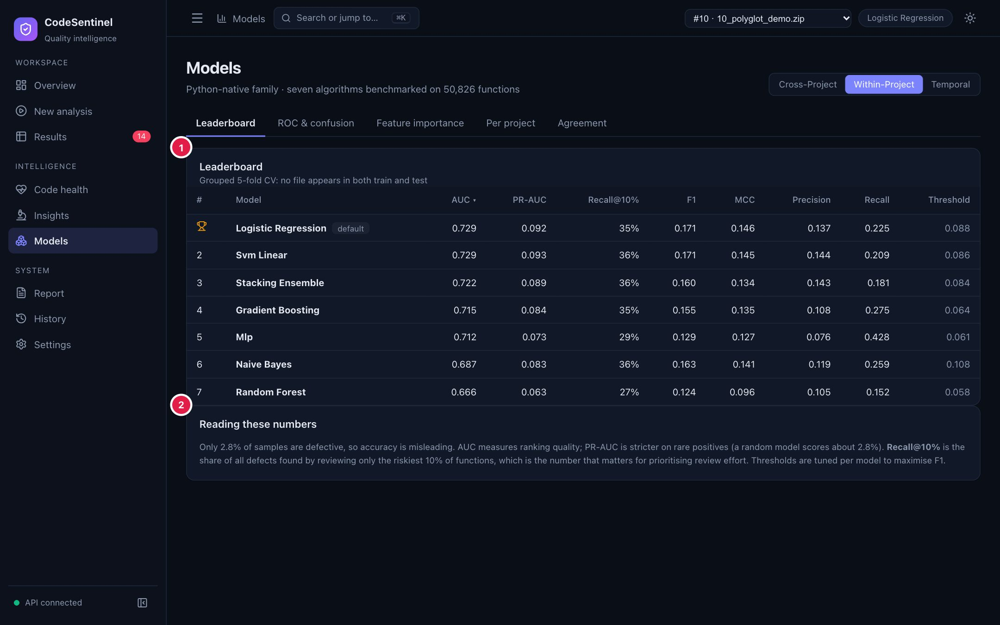

| No. | Element | What it shows |
|---|---|---|
| 1 | **Leaderboard** | All seven models ranked by the selected evaluation, with AUC, PR-AUC, recall at the top 10%, F1, MCC, precision, recall and tuned threshold. |
| 2 | **Reading these numbers** | Short guide to why accuracy is misleading at this base rate and what each metric means. |

### Models: Leaderboard (temporal)

Train on early snapshots and test on later ones.

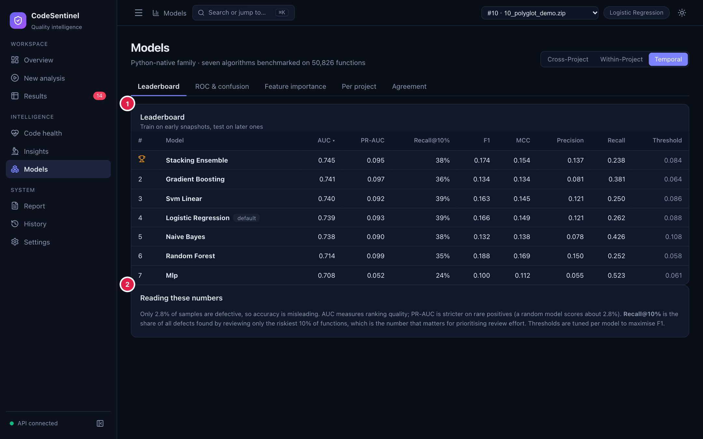

| No. | Element | What it shows |
|---|---|---|
| 1 | **Leaderboard** | All seven models ranked by the selected evaluation, with AUC, PR-AUC, recall at the top 10%, F1, MCC, precision, recall and tuned threshold. |
| 2 | **Reading these numbers** | Short guide to why accuracy is misleading at this base rate and what each metric means. |

### Models: ROC curves and confusion matrix

ROC curves of all models and the confusion matrix of the selected model at its tuned threshold.

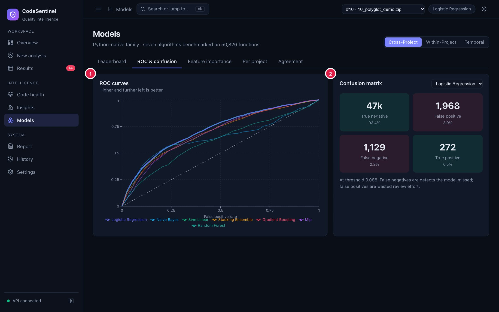

| No. | Element | What it shows |
|---|---|---|
| 1 | **ROC curves** | ROC curve of every model on the selected evaluation; higher and further left is better. |
| 2 | **Confusion matrix** | True and false positives and negatives of the chosen model at its tuned threshold. |

### Models: Feature importance

Which metrics matter most to the random forest and to the logistic regression.

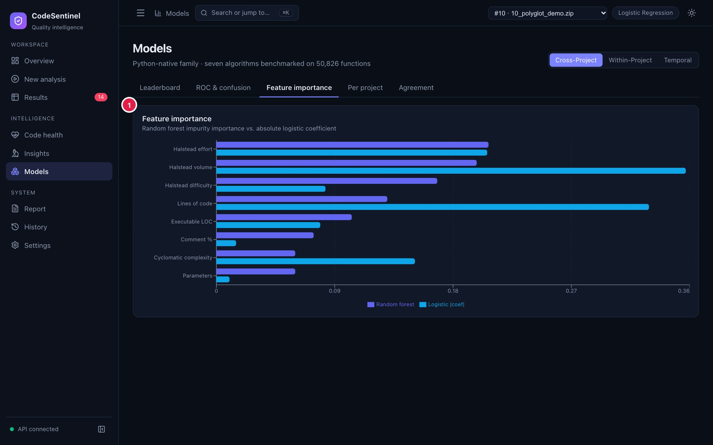

| No. | Element | What it shows |
|---|---|---|
| 1 | **Feature importance** | Random-forest impurity importance compared with the absolute logistic coefficient for each metric. |

### Models: Per-repository AUC

AUC of each model on each held-out repository.

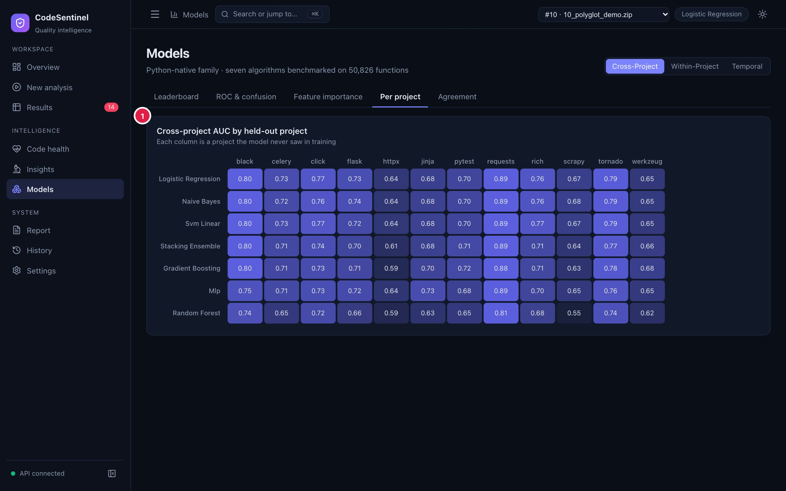

| No. | Element | What it shows |
|---|---|---|
| 1 | **Cross-project AUC by held-out project** | Heat table of AUC for every model on every held-out repository or project. |

### Models: Agreement

How closely the seven models agree on the currently loaded project.

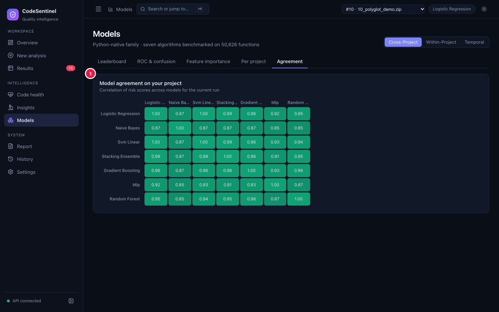

| No. | Element | What it shows |
|---|---|---|
| 1 | **Model agreement on your project** | Correlation of the risk scores of all models on the currently loaded run; high values mean the models rank functions alike. |

### Models: NASA family leaderboard

The NASA MDP benchmark family: 12,211 C/C++ modules from six projects.

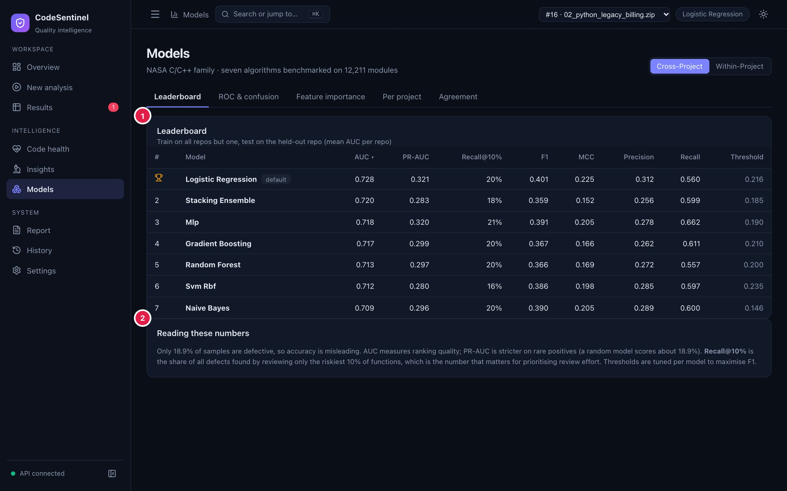

| No. | Element | What it shows |
|---|---|---|
| 1 | **Leaderboard** | All seven models ranked by the selected evaluation, with AUC, PR-AUC, recall at the top 10%, F1, MCC, precision, recall and tuned threshold. |
| 2 | **Reading these numbers** | Short guide to why accuracy is misleading at this base rate and what each metric means. |

### Models: NASA per-project AUC

Cross-project AUC for the six NASA projects.

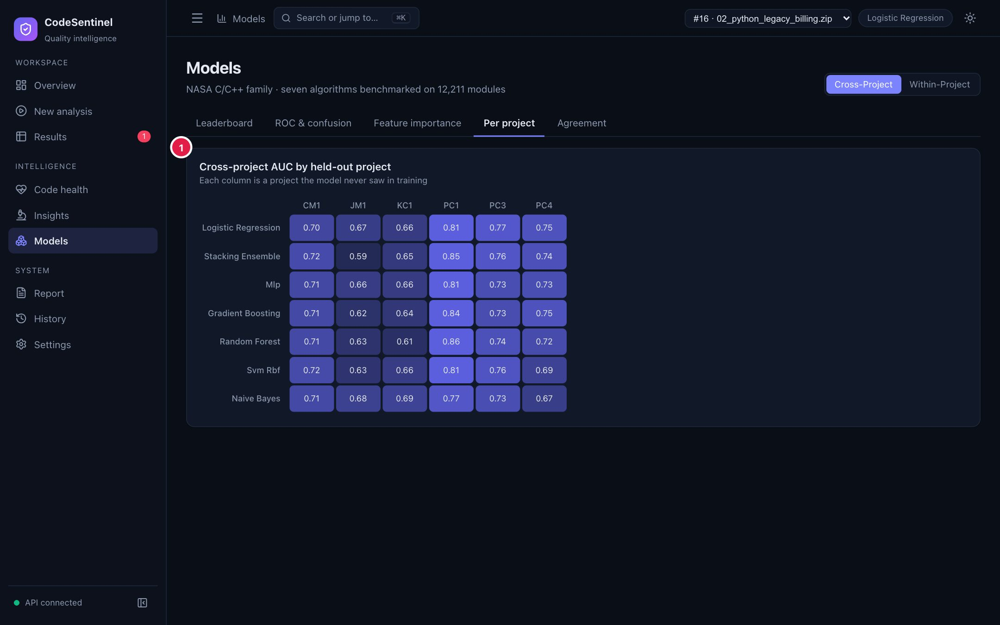

| No. | Element | What it shows |
|---|---|---|
| 1 | **Cross-project AUC by held-out project** | Heat table of AUC for every model on every held-out repository or project. |

## Report

A shareable summary with grade, key findings, the highest-risk functions and a suggested action for each. Export as Markdown, JSON or CSV, or print to PDF.

### Report: polyglot project

Shareable executive summary with grade, key findings, complexity bands and the highest-risk functions; export buttons are at the top.

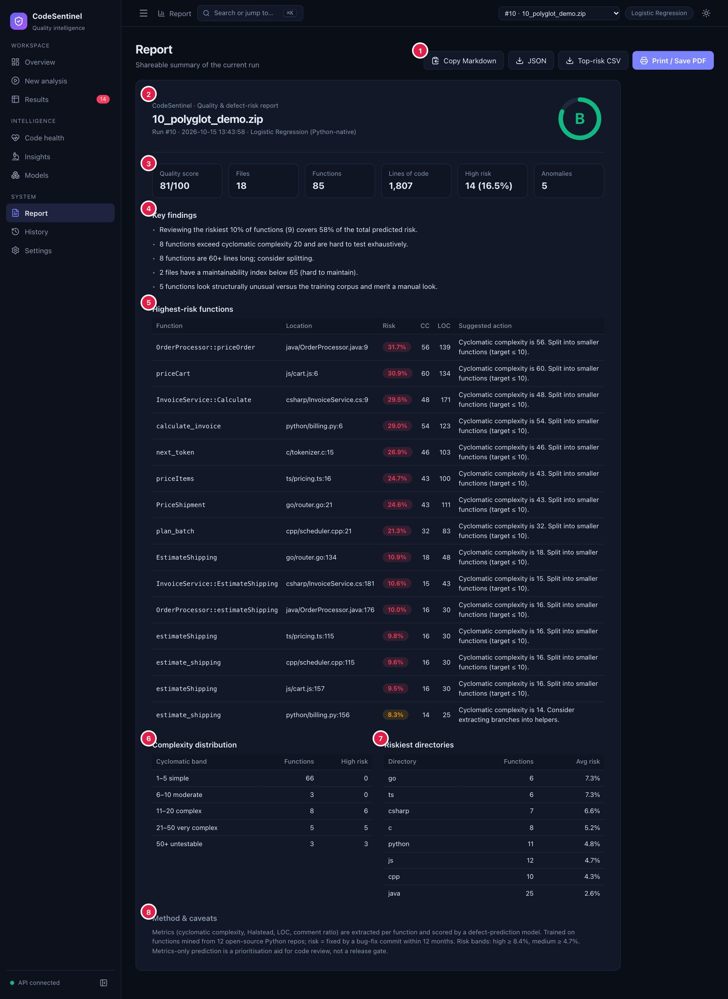

| No. | Element | What it shows |
|---|---|---|
| 1 | **Export buttons** | Copy as Markdown, download the run as JSON, download the top-risk CSV, or print to PDF. |
| 2 | **Report header** | Project name, run number, time, model, model family and the quality grade ring. |
| 3 | **Summary figures** | Quality score, files, functions, lines of code, high-risk count and anomalies. |
| 4 | **Key findings** | The same plain-language findings as the Overview. |
| 5 | **Highest-risk functions** | The top functions with location, risk, complexity, length and the first suggested action. |
| 6 | **Complexity distribution** | Functions and high-risk functions in each cyclomatic-complexity band. |
| 7 | **Riskiest directories** | Average predicted risk per directory. |
| 8 | **Method and caveats** | How the scores were produced and how to read them. |

### Report: clean toolkit

The same report for the clean toolkit, where the highest-risk list contains only low-risk functions.

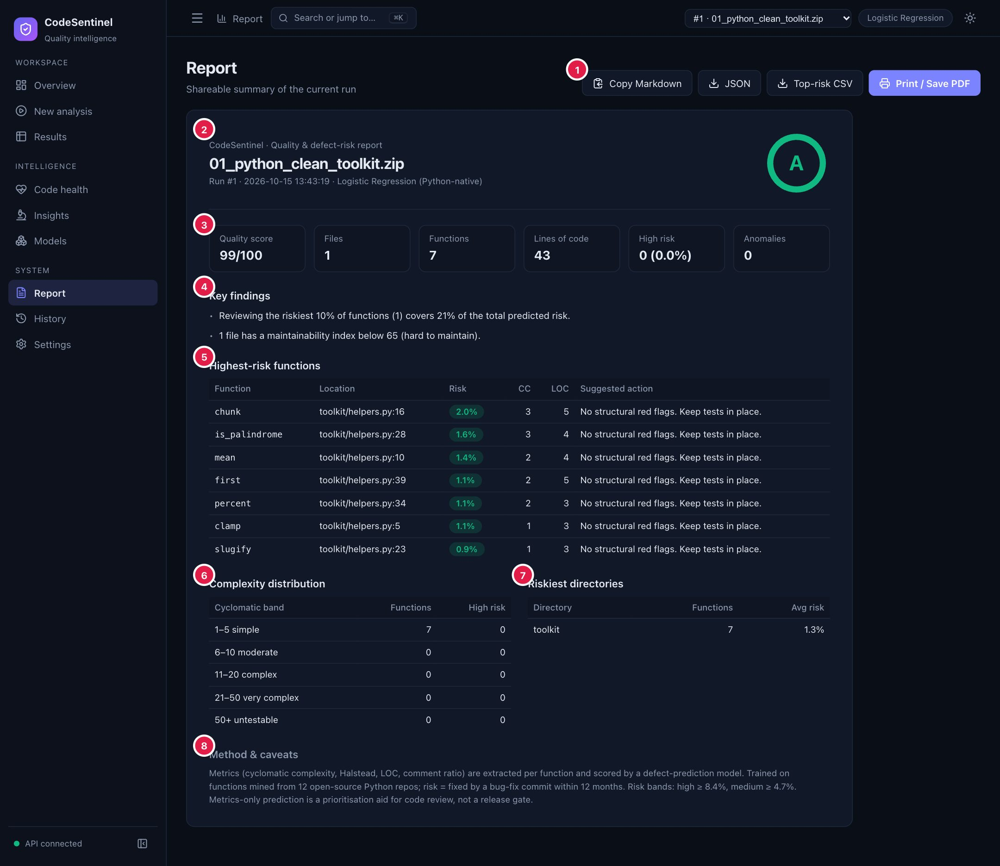

| No. | Element | What it shows |
|---|---|---|
| 1 | **Export buttons** | Copy as Markdown, download the run as JSON, download the top-risk CSV, or print to PDF. |
| 2 | **Report header** | Project name, run number, time, model, model family and the quality grade ring. |
| 3 | **Summary figures** | Quality score, files, functions, lines of code, high-risk count and anomalies. |
| 4 | **Key findings** | The same plain-language findings as the Overview. |
| 5 | **Highest-risk functions** | The top functions with location, risk, complexity, length and the first suggested action. |
| 6 | **Complexity distribution** | Functions and high-risk functions in each cyclomatic-complexity band. |
| 7 | **Riskiest directories** | Average predicted risk per directory. |
| 8 | **Method and caveats** | How the scores were produced and how to read them. |

## History and run comparison

Every analysis is saved. Reopen or delete runs, see a trend for repeated projects and compare two runs side by side.

### History: all saved runs

Every analysis is saved; runs can be opened or deleted and any two can be ticked for comparison.

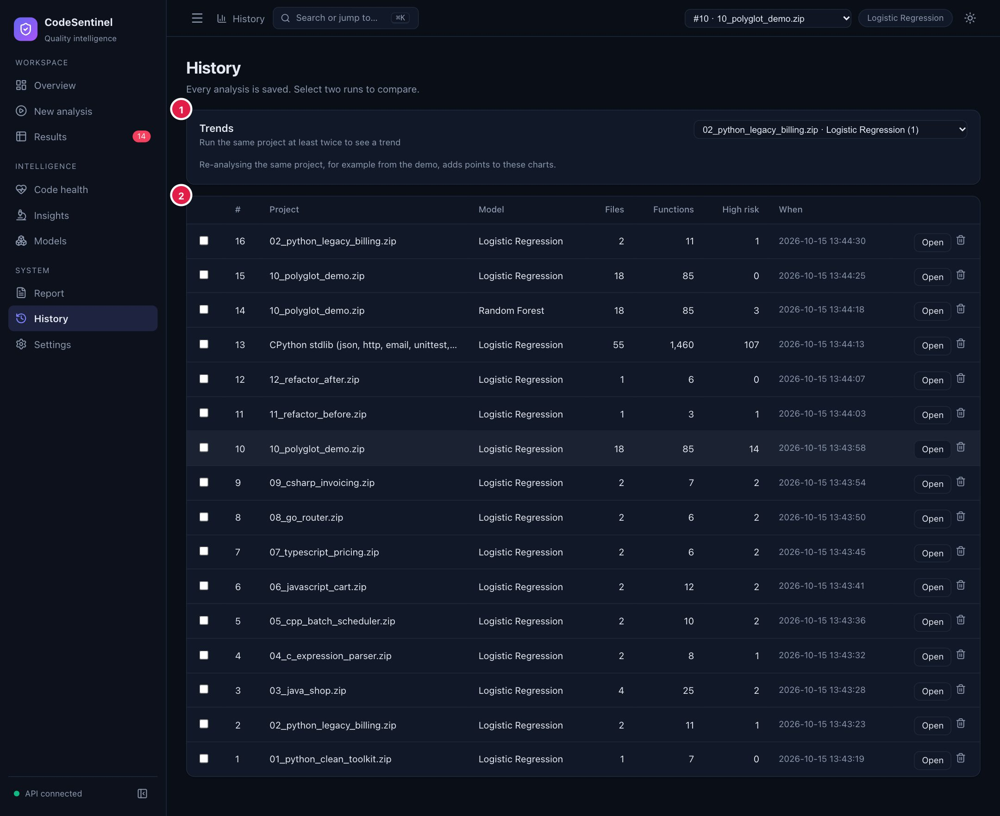

| No. | Element | What it shows |
|---|---|---|
| 1 | **Trends** | Risk and complexity of repeated runs of the same project, to see whether it is improving. |
| 2 | **Results table** |  |

### History: comparing two runs

Ticking the refactoring before and after runs adds a comparison table: high-risk functions, average risk, complexity and anomalies, with the direction of change.

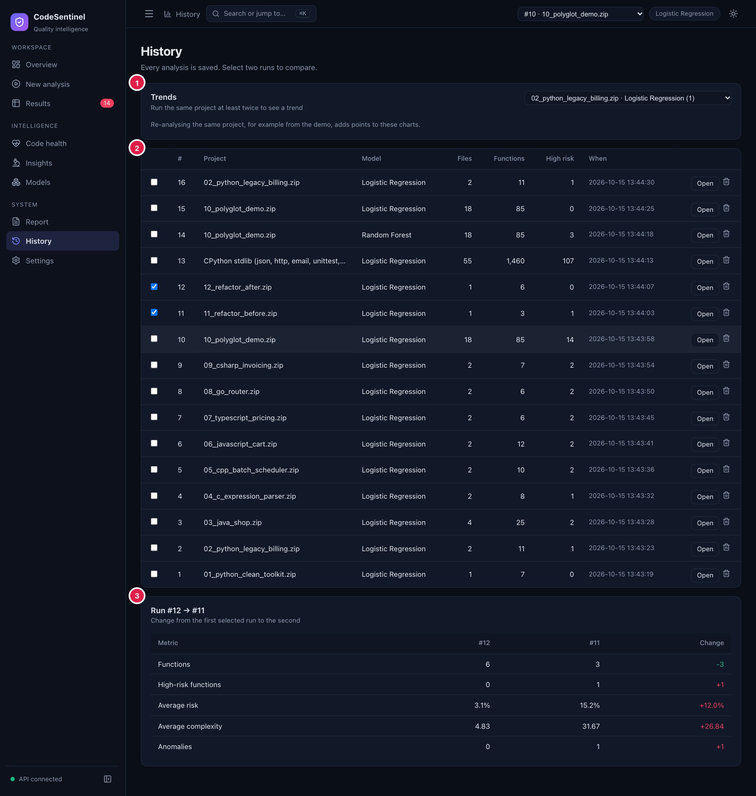

| No. | Element | What it shows |
|---|---|---|
| 1 | **Trends** | Risk and complexity of repeated runs of the same project, to see whether it is improving. |
| 2 | **Results table** |  |
| 3 | **Run #12 → #11** | Change from the first selected run to the second |

## Settings and themes

Risk thresholds (calibrated per model family, editable), minimum function size, default model and family, light and dark themes.

### Settings: defaults

Calibrated thresholds for the model family, minimum function size, default model and theme.

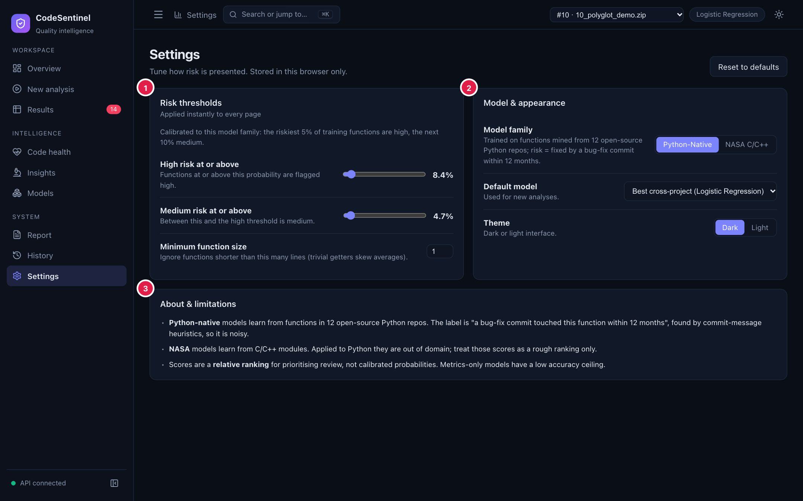

| No. | Element | What it shows |
|---|---|---|
| 1 | **Risk thresholds** | Probability thresholds for high and medium risk (calibrated to the model family by default) and the minimum function size. |
| 2 | **Model & appearance** | Model family, default model and light or dark theme. |
| 3 | **About & limitations** | Short statement of what the scores mean and where they can mislead. |

### Settings: custom high threshold

Raising the high-risk threshold to 20% marks the setting as custom; a 'Use calibrated' link appears.

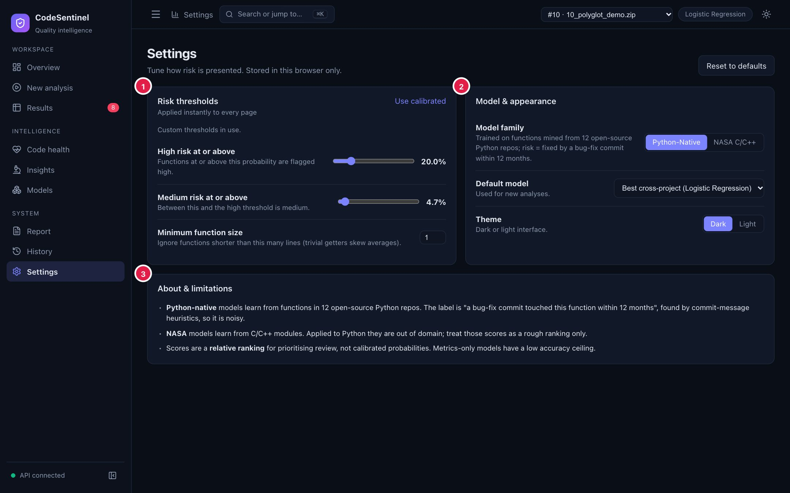

| No. | Element | What it shows |
|---|---|---|
| 1 | **Risk thresholds** | Probability thresholds for high and medium risk (calibrated to the model family by default) and the minimum function size. |
| 2 | **Model & appearance** | Model family, default model and light or dark theme. |
| 3 | **About & limitations** | Short statement of what the scores mean and where they can mislead. |

### Overview after raising the threshold

With the high threshold at 20% only the most extreme functions remain high risk, so the donut and the KPI change instantly.

| No. | Element | What it shows |
|---|---|---|
| 1 | **KPI cards** |  |
| 2 | **At a glance** | Plain-language findings for the run: how much risk sits in the riskiest 10% of functions, how many functions are very complex or long, files with low maintainability and structurally unusual functions, plus the A to F quality grade. |
| 3 | **Hotspot map** | Treemap of files. Rectangle size is the file's lines of code and colour is the highest risk of any function inside it (red high, amber medium, green low). |
| 4 | **Risk distribution** | Share of functions at each risk level, using the calibrated thresholds shown in the panel subtitle. |
| 5 | **Top risky functions** | The eight highest-risk functions with file, line, predicted defect probability and cyclomatic complexity. 'See all' opens the Results page. |
| 6 | **Average risk by directory** | Mean predicted risk of the functions in each folder, to decide which part of the code base to review first. |

### Light theme: Overview

The light theme applies to every page.

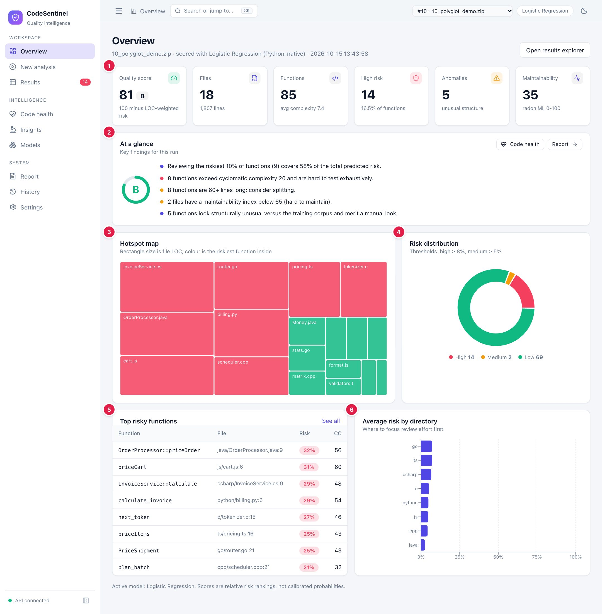

| No. | Element | What it shows |
|---|---|---|
| 1 | **KPI cards** |  |
| 2 | **At a glance** | Plain-language findings for the run: how much risk sits in the riskiest 10% of functions, how many functions are very complex or long, files with low maintainability and structurally unusual functions, plus the A to F quality grade. |
| 3 | **Hotspot map** | Treemap of files. Rectangle size is the file's lines of code and colour is the highest risk of any function inside it (red high, amber medium, green low). |
| 4 | **Risk distribution** | Share of functions at each risk level, using the calibrated thresholds shown in the panel subtitle. |
| 5 | **Top risky functions** | The eight highest-risk functions with file, line, predicted defect probability and cyclomatic complexity. 'See all' opens the Results page. |
| 6 | **Average risk by directory** | Mean predicted risk of the functions in each folder, to decide which part of the code base to review first. |

### Light theme: Code health

Charts and tables follow the theme.

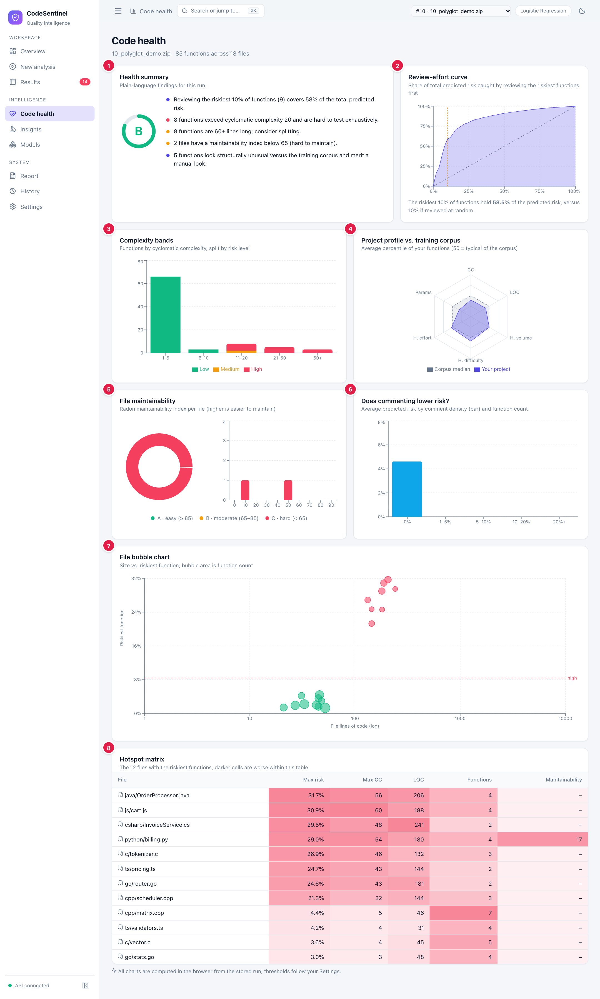

| No. | Element | What it shows |
|---|---|---|
| 1 | **Health summary** | The same plain-language findings as the Overview, with the quality grade ring. |
| 2 | **Review-effort curve** | Share of the total predicted risk captured when functions are reviewed from riskiest to least risky. The dashed diagonal is random review; the dotted marker is the riskiest 10%. |
| 3 | **Complexity bands** | Number of functions in each cyclomatic-complexity band, stacked by risk level. |
| 4 | **Project profile vs. training corpus** | Radar of the average percentile of this project's functions against the training corpus (50 is typical). |
| 5 | **File maintainability** | Radon maintainability index per file (higher is easier to maintain). Available for Python files only. |
| 6 | **Does commenting lower risk?** | Average predicted risk by comment density (bars) with the number of functions in each band. |
| 7 | **File bubble chart** | Each bubble is a file: horizontal position is size, vertical position is the riskiest function, bubble area is the function count. |
| 8 | **Hotspot matrix** | The 12 files with the riskiest functions as a heat table of size, complexity, length and risk. |

## Same project, different model and family

The polyglot sample scored by the default logistic regression, by the random forest and by the NASA model family.

### Same project scored by the random forest

The polyglot project again, this time scored by the random forest instead of the default logistic regression; compare the risk distribution and top functions.

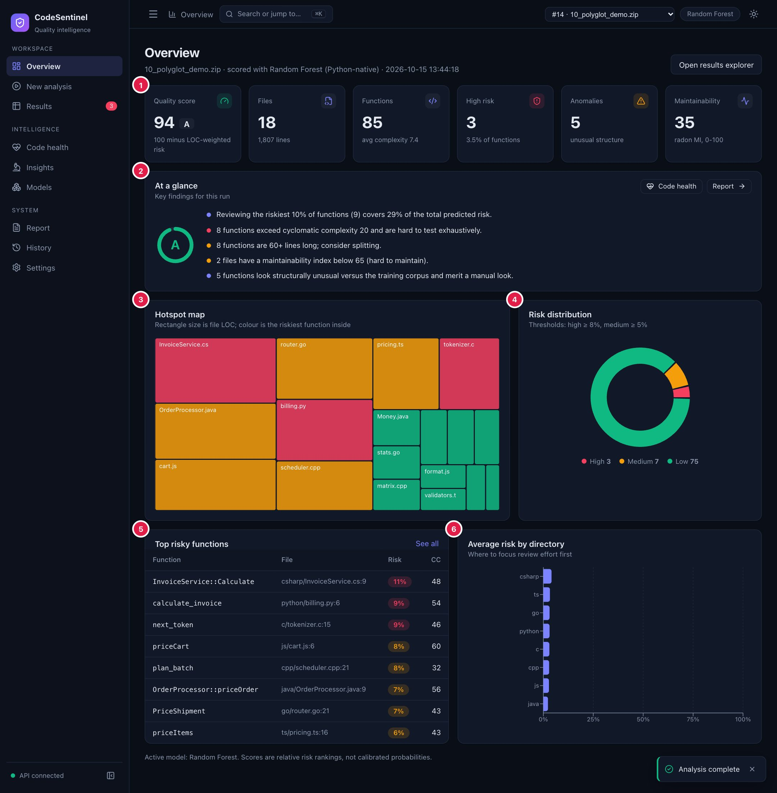

| No. | Element | What it shows |
|---|---|---|
| 1 | **KPI cards** |  |
| 2 | **At a glance** | Plain-language findings for the run: how much risk sits in the riskiest 10% of functions, how many functions are very complex or long, files with low maintainability and structurally unusual functions, plus the A to F quality grade. |
| 3 | **Hotspot map** | Treemap of files. Rectangle size is the file's lines of code and colour is the highest risk of any function inside it (red high, amber medium, green low). |
| 4 | **Risk distribution** | Share of functions at each risk level, using the calibrated thresholds shown in the panel subtitle. |
| 5 | **Top risky functions** | The eight highest-risk functions with file, line, predicted defect probability and cyclomatic complexity. 'See all' opens the Results page. |
| 6 | **Average risk by directory** | Mean predicted risk of the functions in each folder, to decide which part of the code base to review first. |

### Same project scored by the NASA model family

Scored with the NASA C/C++ family (default logistic regression): the thresholds are calibrated to that family and the ranking differs from the Python-native family.

| No. | Element | What it shows |
|---|---|---|
| 1 | **KPI cards** |  |
| 2 | **At a glance** | Plain-language findings for the run: how much risk sits in the riskiest 10% of functions, how many functions are very complex or long, files with low maintainability and structurally unusual functions, plus the A to F quality grade. |
| 3 | **Hotspot map** | Treemap of files. Rectangle size is the file's lines of code and colour is the highest risk of any function inside it (red high, amber medium, green low). |
| 4 | **Risk distribution** | Share of functions at each risk level, using the calibrated thresholds shown in the panel subtitle. |
| 5 | **Top risky functions** | The eight highest-risk functions with file, line, predicted defect probability and cyclomatic complexity. 'See all' opens the Results page. |
| 6 | **Average risk by directory** | Mean predicted risk of the functions in each folder, to decide which part of the code base to review first. |

### Legacy billing project under the NASA family

The legacy billing project scored by the NASA family.

| No. | Element | What it shows |
|---|---|---|
| 1 | **KPI cards** |  |
| 2 | **At a glance** | Plain-language findings for the run: how much risk sits in the riskiest 10% of functions, how many functions are very complex or long, files with low maintainability and structurally unusual functions, plus the A to F quality grade. |
| 3 | **Hotspot map** | Treemap of files. Rectangle size is the file's lines of code and colour is the highest risk of any function inside it (red high, amber medium, green low). |
| 4 | **Risk distribution** | Share of functions at each risk level, using the calibrated thresholds shown in the panel subtitle. |
| 5 | **Top risky functions** | The eight highest-risk functions with file, line, predicted defect probability and cyclomatic complexity. 'See all' opens the Results page. |
| 6 | **Average risk by directory** | Mean predicted risk of the functions in each folder, to decide which part of the code base to review first. |

## Overview of every sample project

The Overview page for each project in [samples/](../samples/README.md), scored with the default model.

### 01_python_clean_toolkit

Python: Small documented helpers.

### 02_python_legacy_billing

Python: Legacy billing engine with one tangled function.

### 03_java_shop

Java: Legacy order processor with clean value classes.

### 04_c_expression_parser

C: Hand-written tokenizer with deep nesting.

### 05_cpp_batch_scheduler

C++: Scheduler with a long rule chain.

### 06_javascript_cart

JavaScript: Cart pricing with formatting helpers.

### 07_typescript_pricing

TypeScript: Typed pricing engine with validators.

### 08_go_router

Go: Shipment pricing with numeric helpers.

### 09_csharp_invoicing

C#: Invoice service with a record class.

### 10_polyglot_demo

All eight: 18 files across every language.

### 11_refactor_before

Python: Legacy pricing function (before refactoring).

### 12_refactor_after

Python: Same behaviour split into small functions (after).

### CPython standard library demo

Built-in demo project (json, http, email, unittest and logging packages).

